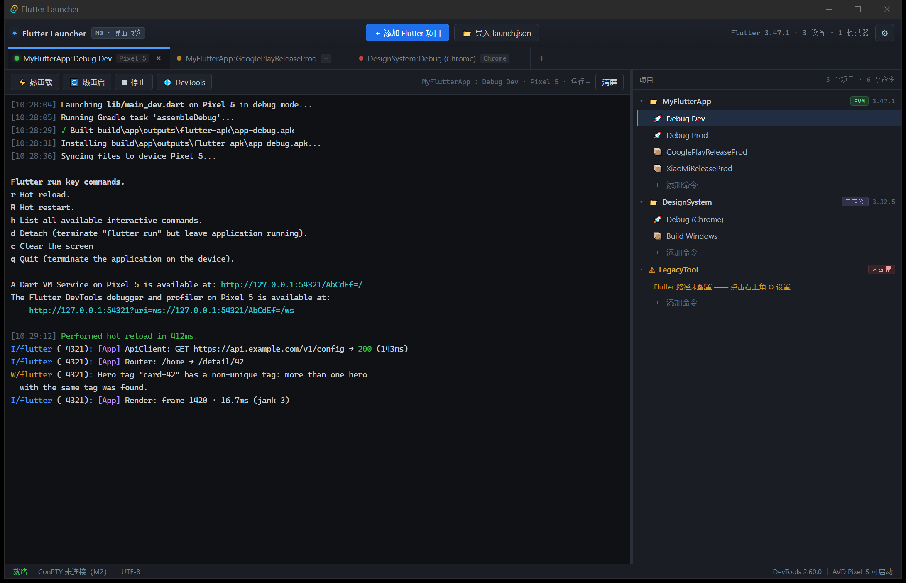

# Flutter Launcher

> 轻量级 **Flutter 应用启动器与发布管理器** —— 不用打开 Android Studio / VS Code，也能跑起来、热重载、打渠道包。
> 界面参考 **WindTerm**：高信息密度、多标签终端、层级树导航。



---

## 当前状态

**M0：界面骨架完成**（纯 UI，数据全部为 Mock）

界面上能看到、点到的都已在位；但**没有任何真实能力接入** —— 没有 PTY、没有 `flutter` 进程、没有设备探测、没有持久化。这些分别在 M1–M7 落地。

| 里程碑 | 内容 | 状态 |
|---|---|---|
| M0 | Tauri 骨架 + WindTerm 风格界面 | ✅ 完成 |
| M1 | 项目管理 + 项目树 + 持久化 | 待做 |
| M2 | ConPTY 会话 + 真实终端 + 进程树回收 | 待做 |
| M3 | 设备/模拟器（`flutter daemon`） | 待做 |
| M4 | 热重载 / 热重启 / 停止 / DevTools | 待做 |
| M5 | 发布构建 + 通知 | 待做 |
| M6 | `launch.json` 导入 | 待做 |
| M7 | 会话恢复 + 打磨 | 待做 |

---

## 快速开始

```bash
npm install
npm run tauri dev
```

首次会编译 Rust（约 1.5 分钟），之后前端改动由 Vite 热更新。

其他命令：

```bash
npx tsc --noEmit     # 类型检查
npm run build        # 前端构建
npm run tauri build  # 打包安装程序
```

### 环境要求

- Windows 10 1809+（**ConPTY** 依赖；本项目在 10.0.19045 上开发）
- Rust 1.85+（msvc toolchain）
- Node.js 20+
- Visual Studio Build Tools（C++ 工作负载）+ Windows SDK
- WebView2 Runtime

---

## 技术栈

| 层 | 选型 |
|---|---|
| 桌面外壳 | Tauri v2 |
| 前端 | Vite + TypeScript（无框架） |
| 终端 | xterm.js 6.0（fit / webgl / unicode11） |
| 后端 | Rust |

---

## 目录结构

```
├── src/                        前端
│   ├── main.ts                 应用入口（界面渲染 + Mock 数据）
│   ├── styles.css              WindTerm 风格深色主题
│   └── vite-env.d.ts
├── src-tauri/                  Rust 后端
│   ├── src/lib.rs              Tauri 入口
│   ├── tauri.conf.json         窗口与应用配置
│   └── Cargo.toml
├── docs/
│   └── screenshot-m0.png       M0 界面截图
├── readme_md_for_ai_agents.md  ★ 权威规格 v2（AI 助手必读）
├── ARCHITECTURE_V2.md          设计推导与源码级证据
└── PROJECT_ANALYSIS.md         v1 需求评估（历史文档）
```

---

## 文档

| 文件 | 作用 |
|---|---|
| [readme_md_for_ai_agents.md](readme_md_for_ai_agents.md) | **唯一权威规格**：决策记录、UI 蓝图、PTY 模型、Flutter 工具链解析、数据模型、验收标准 |
| [ARCHITECTURE_V2.md](ARCHITECTURE_V2.md) | 为什么这样设计：协议证据、权衡分析、风险评估 |
| [PROJECT_ANALYSIS.md](PROJECT_ANALYSIS.md) | v1 规格的缺陷与协议核对（历史，部分结论已反转） |

---

## 几条关键约束（v1 已冻结，勿擅自扩展）

1. **不用 `--machine`**。终端模式与 JSON 模式互斥，走 ConPTY。
2. **不用 pipe 冒充终端**。管道会让 Flutter 降级（无 ANSI、无交互键）。
3. **构建目标动态探测**。Windows 上没有 `ipa` / `macos`。
4. **`.fvmrc` 的 `env` 必须透传**，`flutter` 字段可能是自定义分支名（如 `harmony`）。
5. **v1 不做**搜索 / 分屏 / 同步输入 / 日志落盘 / 时间戳 / 快捷命令栏。

详见规格 §3.1 与 §16。
