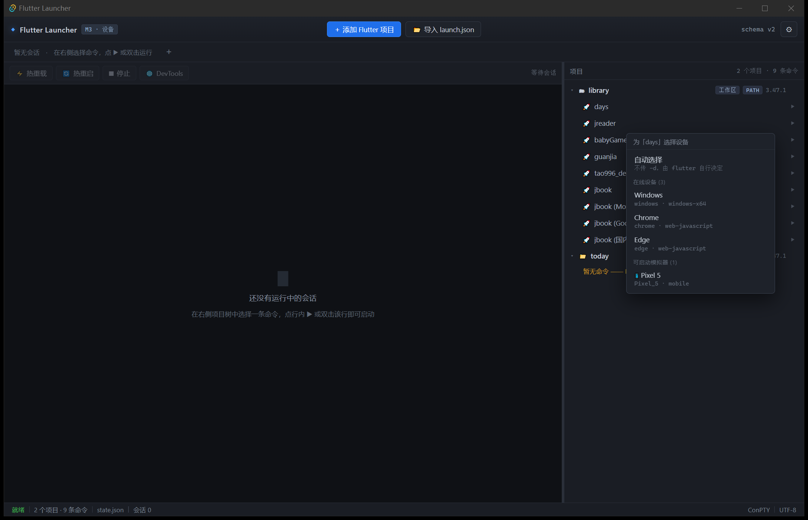

# Flutter Launcher

> 轻量级 **Flutter 应用启动器与发布管理器** —— 不用打开 Android Studio / VS Code，也能跑起来、热重载、打渠道包。
> 界面参考 **WindTerm**：高信息密度、多标签终端、层级树导航。



---

## 当前状态

**M3：设备与模拟器已接入** —— 右键命令即可看到在线设备与**未启动的模拟器**，选中设备直接开跑。

| 里程碑 | 内容 | 状态 |
|---|---|---|
| M0 | Tauri 骨架 + WindTerm 风格界面 | ✅ 完成 |
| M1 | 项目管理 + 项目树 + 持久化 | ✅ 完成 |
| M2 | ConPTY 会话 + 真实终端 + 进程树回收 | ✅ 完成 |
| M3 | 设备/模拟器（`flutter daemon`） | ✅ 完成 |
| M4 | 热重载 / 热重启 / 停止 / DevTools | ✅ 完成（随 M2 一并落地） |
| M5 | 发布构建 + 通知 | 待做 |
| M6 | `launch.json` 高级导入（手动添加命令等） | 待做 |
| M7 | 会话恢复 + 打磨 | 待做 |

### M3 已实现

- **常驻 `flutter daemon`**：按 Flutter 可执行文件复用，`device.getDevices` + `emulator.getEmulators`
- **能看到未启动的模拟器**：`flutter devices` 只列在线设备，`flutter emulators --machine` 根本不存在；daemon 协议才拿得到 `Pixel_5` 这类待启动项
- **设备菜单**：右键命令弹出，分「自动选择 / 在线设备 / 可启动模拟器」；选中设备即带 `-d` 启动，选模拟器则先 `emulator.launch`
- **热插拔**：监听 `device.added` / `device.removed` 事件推送，无需轮询
- **健壮性**：daemon 超时自动杀掉重建；stderr 独立消费避免管道写满阻塞

### M2 已实现

- **ConPTY 会话**：每条命令一个伪终端（`portable-pty`），前端 xterm.js 直接渲染 ANSI 彩色输出
- **流式 UTF-8 解码**：多字节字符被数据块切断时保留尾部，中文日志不乱码
- **DSR 握手**：ConPTY 启动即发 `ESC[6n` 查询光标位置，不应答会**永久卡住**；由后端统一应答 `ESC[1;1R` 并剔除该序列（只应答一次）
- **进程树回收**：Windows Job Object + `KILL_ON_JOB_CLOSE`，关标签/退出应用时连带杀掉 `flutter → dart → gradle`
- **会话状态机**：命中 `Flutter run key commands.` → 🟢；进程退出 → 🔴 并记录退出码
- **控制按钮**：热重载 `r`、热重启 `R`、停止 `q`（5 秒后兜底强杀）、DevTools（从输出解析 URL 打开）
- **命令拼装**：`.bat` 经 `cmd.exe /d /c`（**不加 `/s`**），路径与参数逐项传参，避免引号被二次转义

### M1 已实现

- **项目管理**：目录选择器添加；自动区分「单应用」（含 `pubspec.yaml`）与「工作区」（monorepo，靠 `.vscode/launch.json` + `cwd` 定位子应用）；支持移除与重复校验
- **`launch.json` 导入**：手写 JSONC 状态机（行注释 / 块注释 / 尾逗号）；按 `type == "dart" && request == "launch"` 过滤；`cwd` 相对**工作区根**解析（VS Code 的真实语义，不是相对 `.vscode`）
- **项目树**：真实数据渲染，展示 Flutter 来源（`FVM` / `自定义` / `PATH`）、版本号、`release` 模式标记
- **持久化**：`%APPDATA%\com.flutterlauncher.app\state.json`，`schemaVersion: 2`，原子写入；损坏时备份为 `state.corrupt.json` 后重建
- **Flutter 探测**：解析可执行文件并执行 `--version`

### 测试

```bash
cd src-tauri && cargo test
```

18 个测试：JSONC 解析、真实 monorepo 导入、Flutter 探测、状态往返、损坏恢复、UTF-8 跨块解码、DSR 过滤、命令拼装、**真实 daemon 查询设备与模拟器**。

诊断工具：
```bash
cd src-tauri && cargo run --bin pty_probe   # ConPTY 原始分块
```

> **开发期钩子**（用于无人值守验证）：
> - `FLA_AUTOSTART="<项目ID>|<命令ID>|<设备ID>"` 启动即运行指定命令
> - `FLA_DEVICE_MENU="<项目ID>"` 启动即弹出设备菜单

---

## 快速开始

```bash
npm install
npm run tauri dev
```

首次会编译 Rust（约 1.5 分钟），之后前端改动由 Vite 热更新。

其他命令：

```bash
npx tsc --noEmit     # 类型检查
npm run build        # 前端构建
npm run tauri build  # 打包安装程序
```

### 环境要求

- Windows 10 1809+（**ConPTY** 依赖；本项目在 10.0.19045 上开发）
- Rust 1.85+（msvc toolchain）
- Node.js 20+
- Visual Studio Build Tools（C++ 工作负载）+ Windows SDK
- WebView2 Runtime

---

## 技术栈

| 层 | 选型 |
|---|---|
| 桌面外壳 | Tauri v2 |
| 前端 | Vite + TypeScript（无框架） |
| 终端 | xterm.js 6.0（fit / webgl / unicode11） |
| 后端 | Rust |

---

## 目录结构

```
├── src/                        前端
│   ├── main.ts                 应用入口（项目管理 / 项目树 / 持久化）
│   ├── styles.css              WindTerm 风格深色主题
│   └── vite-env.d.ts
├── src-tauri/                  Rust 后端
│   ├── src/lib.rs              Tauri 命令注册
│   ├── src/ops.rs              业务操作（添加项目 / 导入），纯函数便于测试
│   ├── src/store.rs            状态读写（原子落盘 / 损坏恢复）
│   ├── src/launch.rs           launch.json 解析
│   ├── src/jsonc.rs            JSONC 状态机（注释 / 尾逗号）
│   ├── src/flutter.rs          Flutter 可执行文件解析与版本探测
│   ├── src/pty.rs              ConPTY 会话（UTF-8 流解码 / DSR 应答 / Job Object）
│   ├── src/daemon.rs           flutter daemon 客户端（设备 / 模拟器 / 热插拔）
│   ├── src/bin/pty_probe.rs    ConPTY 诊断探针
│   ├── src/model.rs            数据模型（schemaVersion 2）
│   ├── tauri.conf.json         窗口与应用配置
│   └── Cargo.toml
├── docs/
│   ├── shot-m3.png             M3 界面截图（设备菜单）
│   ├── shot-m3-menu.png        设备菜单细节
│   ├── shot-m2.png             M2 界面截图（真实终端）
│   ├── shot-m1.png             M1 界面截图
│   └── shot-m1-tree.png        项目树细节
├── readme_md_for_ai_agents.md  ★ 权威规格 v2（AI 助手必读）
├── ARCHITECTURE_V2.md          设计推导与源码级证据
└── PROJECT_ANALYSIS.md         v1 需求评估（历史文档）
```

---

## 文档

| 文件 | 作用 |
|---|---|
| [readme_md_for_ai_agents.md](readme_md_for_ai_agents.md) | **唯一权威规格**：决策记录、UI 蓝图、PTY 模型、Flutter 工具链解析、数据模型、验收标准 |
| [ARCHITECTURE_V2.md](ARCHITECTURE_V2.md) | 为什么这样设计：协议证据、权衡分析、风险评估 |
| [PROJECT_ANALYSIS.md](PROJECT_ANALYSIS.md) | v1 规格的缺陷与协议核对（历史，部分结论已反转） |

---

## 几条关键约束（v1 已冻结，勿擅自扩展）

1. **不用 `--machine`**。终端模式与 JSON 模式互斥，走 ConPTY。
2. **不用 pipe 冒充终端**。管道会让 Flutter 降级（无 ANSI、无交互键）。
3. **构建目标动态探测**。Windows 上没有 `ipa` / `macos`。
4. **`.fvmrc` 的 `env` 必须透传**，`flutter` 字段可能是自定义分支名（如 `harmony`）。
5. **v1 不做**搜索 / 分屏 / 同步输入 / 日志落盘 / 时间戳 / 快捷命令栏。

详见规格 §3.1 与 §16。
