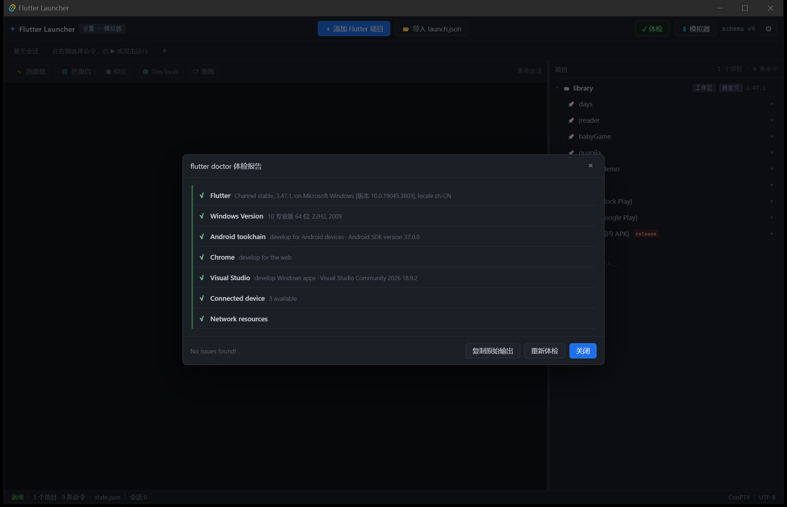
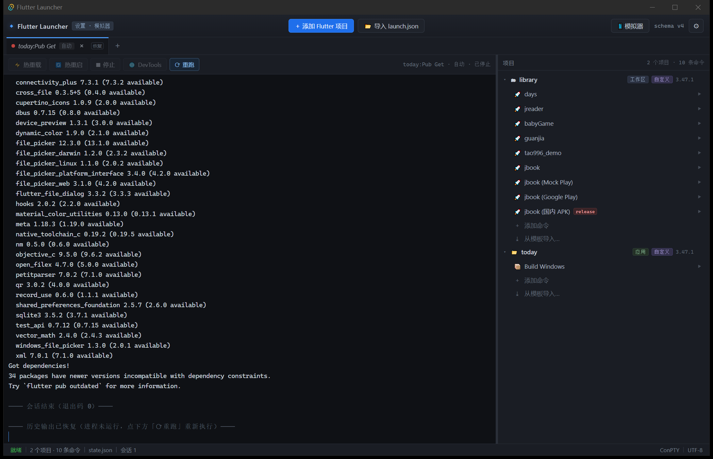
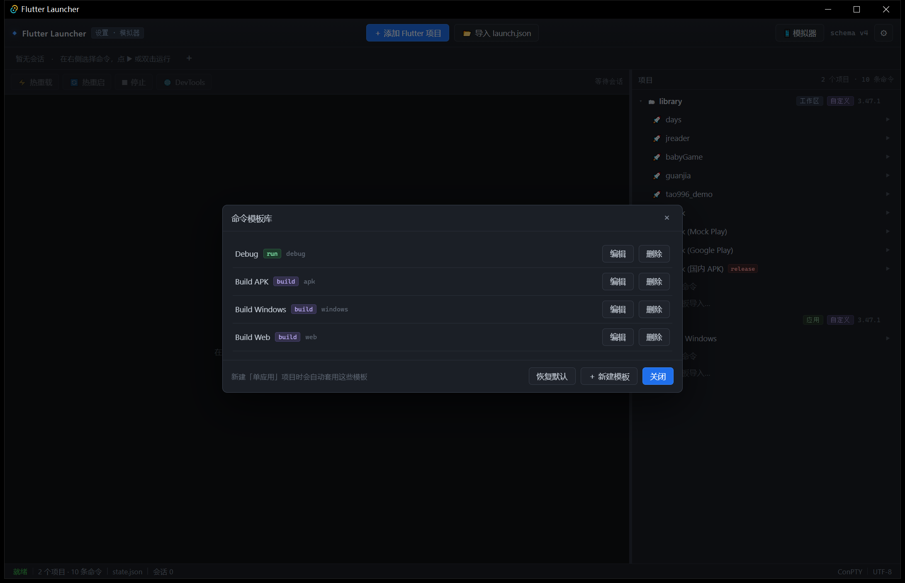
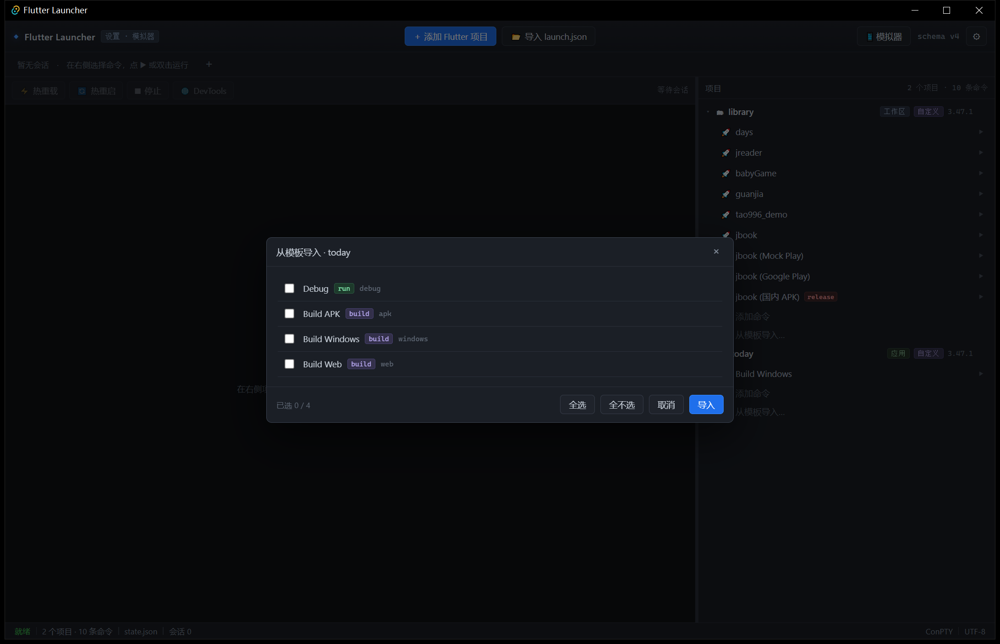
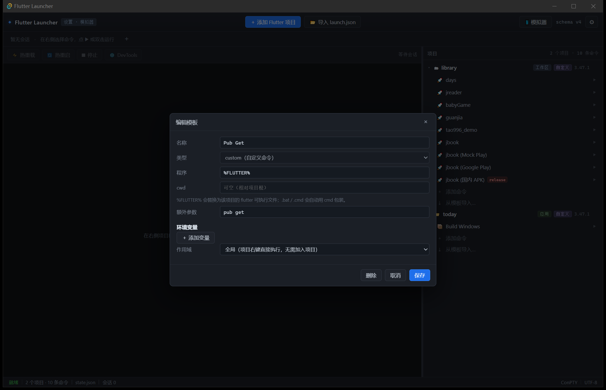
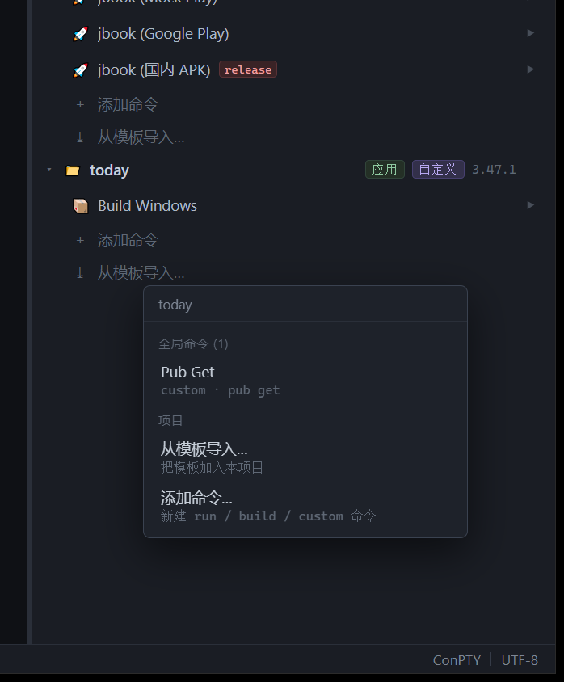
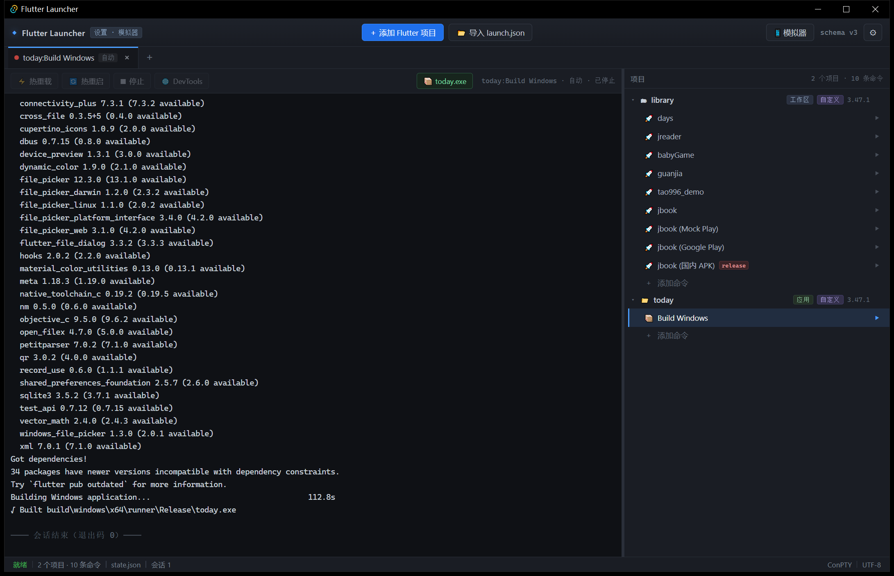
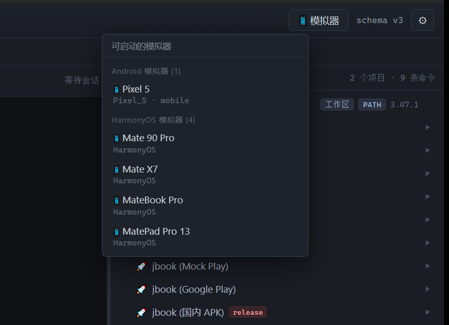
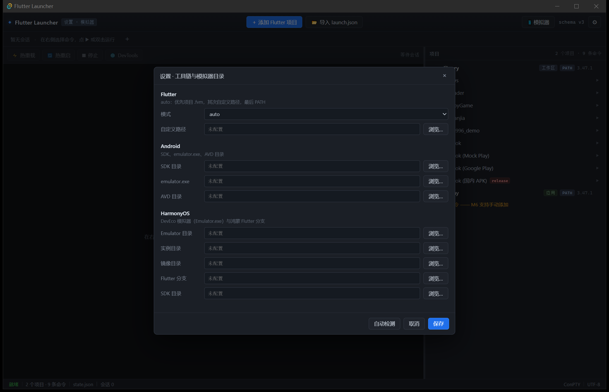

# Flutter Launcher

> 轻量级 **Flutter 应用启动器与发布管理器** —— 不用打开 Android Studio / VS Code，也能跑起来、热重载、打渠道包。
> 界面参考 **WindTerm**：高信息密度、多标签终端、层级树导航。


---

## 当前状态

**M3：设备与模拟器已接入** —— 右键命令即可看到在线设备与**未启动的模拟器**，选中设备直接开跑。
之后又长出了两块：**多生态导入**（`package.json` / `docker-compose.yaml`）与**普通命令共用项目终端**。

| 里程碑 | 内容 | 状态 |
|---|---|---|
| M0 | Tauri 骨架 + WindTerm 风格界面 | ✅ 完成 |
| M1 | 项目管理 + 项目树 + 持久化 | ✅ 完成 |
| M2 | ConPTY 会话 + 真实终端 + 进程树回收 | ✅ 完成 |
| M3 | 设备/模拟器（`flutter daemon`） | ✅ 完成 |
| M3.5 | 设置页（Flutter/Android/HarmonyOS 目录）+ 工具栏模拟器菜单 | ✅ 完成 |
| M4 | 热重载 / 热重启 / 停止 / DevTools | ✅ 完成（随 M2 一并落地） |
| M5 | 发布构建 + 通知 | ✅ 完成 |
| M6 | `launch.json` 高级导入（手动添加命令等） | ✅ 完成（命令增删改 + 模板库） |
| M7 | 会话恢复 + 打磨 | ✅ 完成 |
| P1 | 平台菜单派生 + 备案信息 | ✅ 完成 |
| P2 | 备案公钥（解析 APK 签名块） | ✅ 完成 |
| P3 | 多生态导入（`package.json` / `docker-compose.yaml`） | ✅ 完成 |
| P4 | 普通命令共用项目终端（不再一命令一标签） | ✅ 完成 |
| P5 | 模板分类 / 命令右键分流 / 原子落盘 + 单实例 / 提交前把关 | ✅ 完成 |

### 平台菜单 + 备案信息

**导入了 Flutter 项目后命令为空？这是有意的。** 平台/模式组合不再存成命令，而是从
「项目 + 宿主 + 设备」动态派生：

```
右键项目
├─ 平台
│   ├─ Android ▸  调试运行 / 性能分析运行 / 构建 APK / 构建 AAB / 构建 AAR
│   ├─ Web     ▸  调试运行 / 性能分析运行 / 构建 Web
│   ├─ Windows ▸  …
│   ├─ iOS     ▸  （灰：当前宿主的 flutter 不支持该平台）
│   ├─ Linux   ▸  （灰：…）
│   └─ macOS   ▸  （灰：…）
├─ 全局命令    Pub Get
└─ 从模板导入 / 添加命令
```

- **可用性三条件**：项目有该平台目录 ∧ 宿主 `flutter build` 支持 ∧（运行类）有该平台设备
- **宿主支持度**由 `flutter build --help` 的目标列表推导，**不硬编码**——
  换到 macOS 自动出现 iOS/macOS，不需要重新配
- **运行类置灰会说明原因**："没有可用设备（可先启动模拟器）"
- **工作区项目不显示平台菜单**（根目录没有平台，跑哪个子应用是歧义的）
- 派生动作**不落盘**；恢复后「⟳ 重跑」按平台重新解析设备
- **菜单直接显示真实命令**：`flutter run --debug` / `flutter run --profile` /
  `flutter run --release` / `flutter build apk --release` …，副行是中文说明
- 三种运行模式齐全：调试、性能分析、**发布模式运行（不打包）**——后者容易被漏掉，
  它是 `flutter run --release`，与 `flutter build`（只出产物、不运行）是两回事
- **结果缓存（内存 + 磁盘）**：首次分析要跑 6 次 `flutter build <t> --help` 并拉起 daemon
  （约十秒），之后**跨重启**都直接用缓存；右键菜单里有「重新分析平台信息」强制刷新
- 模拟器列表同样落磁盘缓存，菜单里的 ⟳ 才重新检查
- 缓存在 `%APPDATA%\com.flutterlauncher.app\cache.json`，删掉即可强制全部重算
- 分析在阻塞线程池执行，不会占住主线程卡界面

**HarmonyOS 工程**：目录里有 `ohos/` 就自动改用设置里的鸿蒙 flutter 分支
（`flutter_flutter`），平台菜单因此多出 `HarmonyOS`，构建目标是 `hap` / `app`。
标准 flutter 不认识 `ohos/`、也没有 `build hap`，所以这一步不能省。

**鸿蒙环境变量**：设置 → HarmonyOS 里有全局变量表（`DEVECO_SDK_HOME` / `FLUTTER_GIT_URL` 等），
项目右键「环境变量…」可按项目覆盖。合并顺序：

```
全局鸿蒙变量  <  .fvmrc 的 env  <  项目变量  <  命令自身 env
```

**这些变量只注入有 `ohos/` 的工程**；`.fvmrc` 的 env 属于 FVM 语义，任何工程都生效。
同一个上下文（exe + env + PATH）同时用于会话、daemon、doctor 和宿主能力探测——
不会出现"设备列表用鸿蒙分支、构建却用标准 flutter"这种分裂。

**PATH shim**：鸿蒙工程会在 `%APPDATA%\com.flutterlauncher.app\shims\<项目id>\flutter.bat`
生成一个转发脚本并前置到 PATH。这样应用内手敲 `flutter`、以及构建链内部再调 `flutter`，
都会落到项目自己的分支上——**不需要改你的 `$PROFILE`**。

**FVM 工程**：项目根有 `.fvmrc` 就在名称后标 `FVM`。即使 SDK 不在
`.fvm/flutter_sdk`（走 FVM 全局缓存），也能识别出这是 FVM 工程。

**同名项目**：两个都叫 `jbook` 时，用最具区分度的祖先目录名做后缀——
`jbook ‹library›` 与 `jbook ‹hm-library›`，不会在树里混淆。

**导入 launch.json 的判定**（`import_launch_path`）：先看目录有没有 `pubspec.yaml`——
有则作为**普通 Flutter 项目**导入，launch.json 的命令成为它的自定义命令；
没有则作为**命令集**导入。命令集本身就是命令列表，右键时不显示平台也不显示全局命令。
重复导入同一目录只刷新命令，不重复添加。选目录、选 `.vscode`、直接选 `launch.json` 都可以。

**迁移（schema v4 → v5）**：`Debug` / `Build APK` / `Build Windows` / `Build Web`
四条内置模板退役，已实例化且未改名的命令一并清理；模板库只保留 `Pub Get`。
清理是**幂等**的，不依赖版本号。

**备案信息**：工具栏「📋 备案」→ 选 APK →

- 取数链路经实测选定：包名/版本用 `aapt2 dump badging`，指纹用 `apksigner verify --print-certs`
  （`keytool -printcert -jarfile` 对只有 V2 签名的 APK **直接失败**；JDK 17 的
  `keytool -list -v` **不再输出 MD5**）
- 三要素：应用名称 / 包名 / MD5，各带复制；MD5 统一成大写冒号分隔
- 附加：版本、SDK、签名方案、DN、SHA-1、SHA-256，可「复制全部」
- 调试签名会显著提示"请勿用于备案"
- **公钥**由自实现的 APK Signing Block 解析得到：定位 EOCD → Signing Block →
  V2/V3 块 → `signers → signer → signed_data → digests → certificates` → 证书 DER
  → X.509 的 SPKI → Base64
- **交叉校验**：自解析出的证书 MD5 必须等于 `apksigner` 的 MD5，不一致会在面板上告警
  （实测本机样本两者完全一致）
- 设置里可覆盖 `build-tools` 目录与 `keytool` 路径，留空自动探测


### P3 已实现 · 多生态（npm / Docker）

**同一个目录可能既是 Flutter 工程、又是前端工程、还带 compose 文件**，
所以"生态"挂在**命令**上（`Command.source`），不挂在项目上：

| 入口（工具栏「导入 ▾」） | 生成什么 |
|---|---|
| 导入 `package.json` | 按 `scripts` 每条生成一条命令；包管理器按 lockfile 探测（pnpm > yarn > npm），设置里可强制 |
| 导入 `docker-compose.yaml` | 每个 service 生成 6 个动作 + 整份文件 3 个项目级动作 |

**转发型脚本会被展开**：`"tauri": "tauri"` 这种脚本单独一条命令毫无意义（跑起来只打印帮助），
导入时会**跑一次 `npm run tauri -- --help` 解析出子命令**，换成：

```
tauri dev              run     npm run tauri -- dev
tauri build            build   npm run tauri -- build
tauri build (debug)    build   npm run tauri -- build --debug
tauri android dev      run     npm run tauri -- android dev     ← 有 android 才出现
tauri android build    build   npm run tauri -- android build
tauri info             custom  npm run tauri -- info
```

- **子命令从 `--help` 解析，不硬编码**：tauri 升级后新增/改名照样对得上
- 只把**日常真会用的**放进去；`add` / `permission` / `completions` / `plugin` 这类
  一次性配置操作不进树（它们只是一次性的脚手架，放进去是噪音）
- `ios` 只在 CLI 真有这个子命令时才展开（Windows 上没有）
- **探测失败**（没装依赖 / CLI 不可用）就退回原来那一条裸命令，不会丢东西
- 探测约 1 秒，所以导入命令本身是 `#[tauri::command(async)]`，不占主线程
- 重复导入不会重复生成；CLI 升级后消失的子命令会被标成 `已失效`，不删


**阶段分类：`kind` 一个字段同时表示"执行方式"和"阶段"**

| kind | 含义 | 例子 |
|---|---|---|
| `run` | 长时间运行，独占终端 | `flutter run` / `npm run dev` / `docker compose logs -f` |
| `build` | 一次性产出物，结束发通知 | `flutter build apk` / `npm run build` |
| `custom` | 一次性、无产物 | `npm test` / `docker compose up -d` |

**重新导入不覆盖你的修改**：命令按确定性 id 合并，已存在的只同步执行细节
（**保留你改过的 kind 与名字**）；脚本或服务被删掉时只标「已失效」并划线，**不删数据**。

**Docker 用服务视图，不是命令列表**：

```
🐳 phalcon-admin                     Docker
   nginx        6 个操作      ▶     ← 双击 = 启动（up -d）
   php          6 个操作      ▶
   mysql        6 个操作      ▶

右键服务：启动 / 停止 / 重启 / 日志 / 进入 shell / 删除容器…（二次确认，说明"卷保留"）
右键项目：全部启动 / 全部日志 / 全部停止 / 编辑 docker-compose.yaml / 重新读取 docker-compose.yaml
```

- **编辑 xxx**：用默认编辑器（VS Code）打开项目的配置文件，右键点一下就跳过去
  - docker 项目 → `编辑 docker-compose.yaml`（显示**真实文件名**，可能是 `.yml` / `compose.yaml`）
  - npm 项目 → `编辑 package.json`
  - 判断依据是**文件是否真的存在**（后端 `project_files` 探测），不是项目的"生态标签"；
    所以一个目录同时有 compose 和 package.json 时两条都会出现
- 只有**这个项目真有对应文件**才显示「重新读取 xxx」（compose / package.json / launch.json 各自独立）
- 状态栏的"N 条命令"按**树里看得见的条目**计，不把折叠的服务动作算进去

### P4 已实现 · 普通命令共用项目终端

`docker compose up -d` 跑完就退出。如果每条命令占一个标签，标签立刻变死、越堆越多，
想接着敲 `docker ps` 只能再开一个。

按执行方式分流：

| 命令类型 | 落在哪 |
|---|---|
| `custom` | **项目常驻终端**：命令被"敲"进去，跑完 shell 还在，可以接着敲下一条 |
| `run` | 独立标签，占住终端直到进程结束 |
| `build` | 独立标签 + 结束通知 + 产物按钮 |

- 同一项目的普通命令**复用同一个终端**，不会每次开新标签
- 终端标签**恢复后直接可以输入**（历史留在上面，下面接一个新提示符）
- 普通终端**没有"重跑"按钮**：`↑` 就是历史，Enter 直接再执行

两个踩过的坑：

- **不能用 `pwsh -NoExit -Command "<cmd>"`**：实测 Flutter 退出时会把 shell 一起带走。
  必须开普通交互 shell，再把命令文本打进去（延迟 220ms，避免输入被 shell 初始化吃掉）
- **裸程序名要解析成真实可执行文件**：Docker Desktop 的 bin 里同时躺着
  `docker`（内容是 `#!/usr/bin/env sh`）和 `docker.exe`，直接 `CreateProcessW("docker")`
  会命中脚本并报 `os error 193`；`npm` 同理（真正该跑的是 `npm.cmd`）。
  现在按 PATH 依次找 `.exe` → `.cmd` → `.bat`

### 终端里的路径可点（Ctrl+单击）

`flutter run` 的报错栈、构建错误、`doctor`、docker 日志里都会出现位置文本，
现在可以直接点开：

| 形态 | 例子 | 打开方式 |
|---|---|---|
| `package:` URI | `package:tao996/src/translation/translation.dart:119:7` | VS Code 跳到 119 行第 7 列 |
| 绝对路径 | `C:/Users/mb/jbook\screenshots\a.png`（斜杠混用是真实存在的） | 系统默认程序 |
| 相对路径 | `lib/main.dart:12:5`（相对会话 cwd） | VS Code 跳到行列 |

- **Ctrl+单击**才打开（跟随 VS Code / Android Studio 终端），避免选文字时误触
- **右键**在链接上可「用 VS Code 打开 / 在资源管理器中定位 / 复制路径」
- 文件不存在时提示「文件不存在：<路径>」，不做静默失败

**`package:` 怎么解析**：从会话 cwd 逐级向上找 `.dart_tool/package_config.json`，
取 `rootUri`（可能是 `file:///…` 绝对 URI，也可能是 `../../packages/foo` 相对路径），
再拼 `lib/<剩余路径>`。所以**没跑过 `flutter pub get` 的工程点不动**。

**必须是 `Code.exe`**：PATH 里的 `code` 是 `code.cmd`/无扩展名脚本，和 `npm`/`docker`
同一个坑。`Code.exe --goto "文件:行:列"` 走 argv，没有 `cmd.exe` 的引号问题，也没有注入风险。

**但新版 VS Code 是「Electron 二进制 + 版本子目录」布局**：

```
Microsoft VS Code\
  Code.exe                       ← 光杆跑 --goto 会 exit 9
  e646868227\resources\app\out\cli.js   ← 真正的 app payload（目录名是版本哈希）
  bin\code.cmd                   ← 它做的就是 ELECTRON_RUN_AS_NODE=1 Code.exe <cli.js> …
```

所以要按 `code.cmd` 的方式调用：**设 `ELECTRON_RUN_AS_NODE=1`，把 cli.js 当第一个参数**。
**cli.js 靠扫描 `*\resources\app\out\cli.js` 找，不能硬编码目录名**——
VS Code 自动升级会换哈希目录（实测从 `6d62b1d5da` 变成 `e646868227`，`code.cmd` 同步改，
写死的话升级后所有"打开文件"功能立刻失效）。

> 限制：路径被终端宽度折成两行时不可点（单行内匹配）。

### 日志搜索与清空

终端控制条上多了两个按钮，**所有会话都能用**（flutter run / 构建输出 / docker 日志 / 终端）：

**🔍 搜索（Ctrl+F）** —— 浮在终端右上角，不占布局

```
┌ 日志…                        ⌃ ⌄   2/17   × ┐
```

- 计数直接显示 `当前/总数`；没有命中显示 **`0 个`**（红色）
- `Enter` 下一个 / `Shift+Enter` 上一个 / `Esc` 关闭
- **不区分大小写**（日志搜索的常见需求）
- 搜的是整个缓冲区，**包括恢复的历史输出**
- 切 tab 会自动收起（搜索是针对单个会话的）

**🧹 清空** —— 真清空，不是 Flutter 里按 `c` 那种"只清屏幕"

| 位置 | 处理 |
|---|---|
| xterm 回滚区 | `term.clear()` 清整个 buffer（**实测 673 行 → 36 行**，回滚区全没了）|
| 内存快照 | 立即 `persistSessions()` |
| `sessions.json` | 一起被覆盖成空，**重启不会又冒出来** |

- **只清显示**：不停进程、不向 PTY 发任何按键
- 不弹确认框（进程不受影响，误点代价只是丢日志）

**📂 项目** —— 用编辑器打开**当前会话的项目目录**（整个目录当工作区）

- 取的是会话的 `cwd`，所以单应用项目打开应用目录，命令带自定义 `cwd` 时打开那个子目录
- 走的是 `--reuse-window <目录>`，不会每次点击都开新窗口
- 和「编辑 xxx」是同一套编辑器设置（设置 → 通用 → 编辑器）

### 命令右键：按"会不会连设备"分流

**不是所有命令都该弹设备菜单。** npm 的 `build`、模板里的 `Pub Get` 跟设备毫无关系，
给它们列「自动选择 / Windows / Chrome / Pixel 5」是纯误导。

| 命令类型 | 右键菜单 |
|---|---|
| flutter run 类（`source=launch-json`，或 program 含 flutter，且 `kind=run`） | 自动选择 / 在线设备 / 可启动模拟器 / 编辑命令 |
| 其余（npm、docker、build、模板） | 运行（副标题说明落点）/ 编辑命令… / 删除命令 |

判定要照顾一个坑：`launch.json` 生成的命令 **program 是空的**（后端才拼 `flutter run`），
只看 program 会把它们误判成"不需要设备"。

### 数据安全：原子落盘 + 单实例

- **落盘是原子替换**：临时文件名带 pid + 纳秒，写完直接 `rename` 覆盖。
  Rust 的 `fs::rename` 在 Windows 上走 `MoveFileEx(MOVEFILE_REPLACE_EXISTING)`，
  本身就能替换已存在文件——**不要"先删后改名"**，那会留下"state.json 不存在"的窗口，
  这期间断电就把配置丢了
- `state.json` 与会话记录（`sessions.json`）共用 `atomic::write_atomic`
- **单实例**（`tauri-plugin-single-instance`）：第二个实例启动即退出，并把已有窗口拉到前面。
  两个进程同时写同一份 `state.json`，后写的会把先写的改动整个覆盖——
  原子写只保证文件不损坏，救不了这种语义上的丢失

### 提交前把关（husky）

```bash
.husky/pre-commit
  npm run typecheck    # tsc --noEmit
  npm run test         # cargo test --manifest-path src-tauri/Cargo.toml
```

约 6 秒。着急时 `git commit --no-verify` 跳过。

**刻意没接 Prettier 自动格式化**：`src/main.ts` 有 5000+ 行，全量重排会让真实改动
淹没在"整文件重写"的 diff 里；格式化应该单独做一次、单独提交。

### 体检（§6.6 / §14）· 工具栏按钮

启动后后台跑一次 `flutter doctor`，状态直接显示在工具栏按钮上，点开是完整报告：

| 状态 | 按钮 |
|---|---|
| 进行中 | `⏳ 体检` |
| 全部正常 | `✓ 体检`（绿） |
| 有问题 | `! 体检 N`（黄，N = 问题项数） |
| 执行失败 | `✗ 体检`（红，悬停看原始报错） |

- **符号陷阱**：`flutter_tools/lib/src/base/logger.dart:738` 在 `supportsEmoji == false` 时
  把 `✓` 换成 `√`、`✗` 换成 `X`、`⚠️` 换成 `!`。解析器**两套符号都接受**，
  否则在中文终端上永远匹配不到状态行
- **修复指引**：从 `To resolve this, run:` 与已知问题表里提取命令，可复制
- **在终端执行**：白名单内的修复动作（如 `flutter doctor --android-licenses`）
  可直接起一个 PTY 会话跑，许可证确认可交互输入 `y`
- 失败时原样呈现 Flutter 自己的报错，而不是"未知错误"
- **不主动跑，只读缓存**。`flutter doctor` 实测 **23 秒**，属于"一次就好"的操作：
  - 启动时只用磁盘缓存（`cache.json` 的 `doctor` 段），**不会**触发探测
  - 没有缓存时按钮显示中性的 `体检`，点一下才真正运行
  - 结果不设过期：除非用户点「重新检查」，否则一直用缓存
  - 代价是可能看到旧结果——报告里带检查时间，介意就点一次刷新
- **必须跑在线程池上**（`#[tauri::command(async)]`）：早期它是同步命令，
  在 Tauri v2 里同步命令跑在**主线程**——启动时界面会整整冻结 23 秒
  （Windows 直接标记"无响应"），连关闭窗口也要等它跑完（实测退出要 8-11 秒）。
  改成异步后：启动 1 秒内可交互、退出 0.2 秒




### M7 已实现 · 会话恢复（D-10）

重启应用后，**tab 壳与历史输出都在，但进程不自动拉起**：

- 元数据（标题、设备、模式、所属项目/命令/模板、退出码、产物）随会话落盘
- 终端缓冲用 `@xterm/addon-serialize` 序列化成 ANSI 原样保存并回放
- 恢复的 tab 带 `恢复` 角标，状态 🔴「已停止」，控制条点亮 **⟳ 重跑**
- **恢复的 tab 在被点「重跑」之前绝不写 PTY**：键盘输入只提示，不转发
- 预算：单会话 ≤ 2 MB、全局 ≤ 20 MB、最多 20 个；超出时从最旧内容截断
- `sessions.json` 损坏时备份为 `sessions.corrupt.json` 后重建



### 命令模板库（解决"新项目命令为空"）

- **全局模板**：设置 → 命令模板，可新建 / 编辑 / 删除 / 恢复默认（内置 Debug、Build APK、Build Windows、Build Web、Pub Get）
- **三种类型**：
  - `run` — `flutter run`（可指定 `-t` 入口与 debug/profile/release）
  - `build` — `flutter build <目标> --release`（目标动态探测）
  - `custom` — 任意程序 + 参数；`%FLUTTER%` 会替换成该项目的 flutter 可执行文件
- **环境变量**：键值对随命令保存，直接注入 PTY 子进程
- **作用域**：
  - `project` — 导入到项目后才能执行
  - `global` — **项目右键即可执行，不写入项目命令列表**
- **自动套用**：新增「单应用」项目时自动把模板实例化为该项目的命令，不再是空树
- **按需导入**：项目树底部「⤓ 从模板导入…」，勾选后导入（支持全选 / 全不选，按名称+类型去重）
- **分类**：模板带 `category`（Flutter / npm / Docker / 其他），决定模板库里的分组和导入时的筛选条；
  老模板没有这个字段时按 program/args 自动推断（`%FLUTTER%`→Flutter、npm/pnpm/yarn→npm、
  docker→docker），模板库右侧的下拉可以直接改
- **工作区不自动套用**：monorepo 的命令来自 `launch.json`，避免污染









### M5 已实现

- **构建目标动态探测**：解析 `flutter build --help` 的子命令列表，**不硬编码**。
  Windows 宿主没有 `ipa` / `macos`
- **flavor 支持度探测**：逐个执行 `flutter build <target> --help` 检查是否含 `--flavor`
  （实测 `apk`/`windows` 支持，`web` 不支持），不支持时输入框置灰
- **命令编辑对话框**：树里「＋ 添加命令」可建 run / build 两类命令；右键命令可编辑或删除
- **产物解析**：从终端流里匹配 `✓ Built <path>`，在控制条生成 `📦 产物名` 按钮，点击在资源管理器定位
- **构建通知**：结束（成功或失败）发系统通知，含项目与产物/退出码
- **退出码可见**：终端末尾打印 `──── 会话结束（退出码 N）────`，标签转 🔴



### 设置页与模拟器菜单（M3.5）

- **工具栏「📱 模拟器」**：聚合两个来源，点条目即启动
  - Android AVD ← 直接驱动 `emulator.exe -list-avds`，并把设置里的
    SDK / AVD 目录通过 `ANDROID_AVD_HOME` 等注入子进程（自定义 AVD 目录才真正生效）；
    未配置时回退 `flutter daemon`
  - HarmonyOS 实例 ← DevEco `Emulator.exe -list`
- **列表缓存**：首次打开查询并缓存，之后直接渲染；点标题栏右侧 **⟳** 才重新检查
- **设置页**（⚙）**单页垂直滚动**（不分页签；弹窗固定尺寸，内容内部滚动），分区顺序：
  命令模板 → 会话恢复 → 终端 → 编辑器 → Flutter → Android → 鸿蒙 → Npm → Docker
  - 命令模板库入口 / 会话恢复 / 终端程序 / 默认编辑器（VS Code）
  - Flutter：`auto` / `custom` / `fvm` + 自定义路径
  - Android：SDK 目录 / `emulator.exe` / AVD 目录 / build-tools / keytool
  - 鸿蒙：`Emulator.exe` 目录 / 实例目录 / 镜像目录 / 鸿蒙 Flutter 分支 / SDK / 全局环境变量
  - Npm：包管理器（auto/npm/pnpm/yarn）/ node 目录
  - Docker：docker 路径 / compose 风格（v2 / v1 / auto）
- **一键自动检测**：不扫全盘，只用环境变量 + `hdc.exe` 反推 + 常见安装位置。
  **只探测、不写入**——检测结果与输入框里的值不一致时（多半是用户手填过），
  在输入框下方显示 `检测到：<值>` + 「填写」按钮，点它才覆盖。
  填一次、存一次盘，不想用就无视它。
- **开箱即用**：HarmonyOS 路径未配置时自动回退到探测结果






### M3 已实现

- **常驻 `flutter daemon`**：按 Flutter 可执行文件复用，`device.getDevices` + `emulator.getEmulators`
- **能看到未启动的模拟器**：`flutter devices` 只列在线设备，`flutter emulators --machine` 根本不存在；daemon 协议才拿得到 `Pixel_5` 这类待启动项
- **设备菜单**：右键命令弹出，分「自动选择 / 在线设备 / 可启动模拟器」；选中设备即带 `-d` 启动，选模拟器则先 `emulator.launch`
- **设备列表只查一次**：首次打开菜单才去问 `flutter daemon`（要拉起进程，好几秒），
  之后一直复用；要最新列表点菜单里的「⟳ 刷新设备列表」。模拟器菜单同理（标题栏 ⟳）
- **热插拔**：监听 `device.added` / `device.removed` 事件推送，无需轮询
- **健壮性**：daemon 超时自动杀掉重建；stderr 独立消费避免管道写满阻塞

### M2 已实现

- **ConPTY 会话**：每条命令一个伪终端（`portable-pty`），前端 xterm.js 直接渲染 ANSI 彩色输出
- **流式 UTF-8 解码**：多字节字符被数据块切断时保留尾部，中文日志不乱码
- **DSR 握手**：ConPTY 启动即发 `ESC[6n` 查询光标位置，不应答会**永久卡住**；由后端统一应答 `ESC[1;1R` 并剔除该序列（只应答一次）
- **进程树回收**：Windows Job Object + `KILL_ON_JOB_CLOSE`，关标签/退出应用时连带杀掉 `flutter → dart → gradle`
- **会话状态机**：命中 `Flutter run key commands.` → 🟢；进程退出 → 🔴 并记录退出码
- **控制按钮**：热重载 `r`、热重启 `R`、停止 `q`（5 秒后兜底强杀）、DevTools（从输出解析 URL 打开）
- **命令拼装**：`.bat` 经 `cmd.exe /d /c`（**不加 `/s`**），路径与参数逐项传参，避免引号被二次转义

### M1 已实现

- **项目管理**：目录选择器添加；自动区分「单应用」（含 `pubspec.yaml`）与「工作区」（monorepo，靠 `.vscode/launch.json` + `cwd` 定位子应用）；支持移除与重复校验
- **`launch.json` 导入**：手写 JSONC 状态机（行注释 / 块注释 / 尾逗号）；按 `type == "dart" && request == "launch"` 过滤；`cwd` 相对**工作区根**解析（VS Code 的真实语义，不是相对 `.vscode`）
- **项目树**：真实数据渲染，展示 Flutter 来源（`FVM` / `自定义` / `PATH`）、版本号、`release` 模式标记
- **持久化**：`%APPDATA%\com.flutterlauncher.app\state.json`，`schemaVersion: 2`，原子写入；损坏时备份为 `state.corrupt.json` 后重建
- **Flutter 探测**：解析可执行文件并执行 `--version`

### 测试

```bash
cd src-tauri && cargo test
```

82 个测试：JSONC 解析、真实 monorepo 导入、Flutter 探测、状态往返、损坏恢复、UTF-8 跨块解码、DSR 过滤、命令拼装、真实 daemon 查询设备与模拟器、工具链自动检测、模板导入与去重、自定义命令与环境变量、会话日志预算与损坏备份、doctor 输出解析（含 Windows 符号替换）、Android AVD 目录解析、APK 签名块解析（MD5 与 apksigner 交叉验证）、npm 包管理器探测与脚本分类、compose 解析与服务命令生成、可执行文件解析（`docker` → `docker.exe`）、外部程序不被当成 `flutter run`、模板分类推断、原子落盘（覆盖写不留临时文件 / 并发写不产生半个 JSON）。

诊断工具：
```bash
cd src-tauri && cargo run --bin pty_probe   # ConPTY 原始分块
```

> **开发期钩子**（用于无人值守验证，不设变量时完全无副作用）：
> - `FLA_AUTOSTART="<项目ID>|<命令ID>|<设备ID>"` 启动即运行指定命令
> - `FLA_DEVICE_MENU="<项目ID>"` 启动即弹出设备菜单
> - `FLA_PROJ_MENU="<项目ID>"` / `FLA_SUBMENU="<平台名>"` 启动即展开项目菜单（可指定子菜单）
> - `FLA_ENV="<项目ID>"` 打开环境变量对话框 / `FLA_TERMINAL="<项目ID>"` 打开项目终端
> - `FLA_SETTINGS="1|<分区名>|detect"` 打开设置页（可滚到指定分区，或自动点一次自动检测）
> - `FLA_TEMPLATES` / `FLA_EXAMPLES`
> - `FLA_IMPORT_MENU` / `FLA_SERVICE_MENU="<服务名>"` 展开导入菜单 / 服务右键菜单
> - `FLA_IMPORT_PKG="<package.json>"` / `FLA_IMPORT_COMPOSE="<compose>"` / `FLA_REIMPORT_DOCKER=1`
> - `FLA_RERUN=1` 对恢复的第一个会话触发重跑 / `FLA_DOCTOR_DETAIL` / `FLA_FILING`
> - `FLA_OPEN_LOCATION="<cwd>|<文本>"` 走一遍"点路径"的完整链路（开编辑器 / 系统程序）
> - `FLA_TERM_FIND="<文本>"` 打开搜索条并搜这段文字 / `FLA_TERM_DEBUG=clear` 清空当前会话
>   并把清空前后缓冲区行数打到 toast（验证是否真的清掉回滚区）

---

## 快速开始

```bash
npm install
npm run tauri dev
```

首次会编译 Rust（约 1.5 分钟），之后前端改动由 Vite 热更新。

### 打包

```bash
npm run tauri build
```

产物在 `src-tauri/target/release/bundle/`：

| 产物 | 大小 | 说明 |
|---|---|---|
| `nsis/Flutter Launcher_0.1.0_x64-setup.exe` | 2.0 MB | 推荐，单文件安装器 |
| `msi/Flutter Launcher_0.1.0_x64_en-US.msi` | 3.0 MB | 需要 MSI 部署时用 |

- 绿色版：直接分发 `src-tauri/target/release/flutter-launcher.exe`（5.9 MB），无需安装
- 依赖只有 **WebView2 运行时**（Win10 1803+ / Win11 已内置）
- 版本号在 `src-tauri/tauri.conf.json` 的 `version` 字段，改完重新打包即可
- 数据目录跟随 `identifier`：`%APPDATA%\com.flutterlauncher.app\`
  （**改 identifier 会换目录，等于清空已有项目配置**）

其他命令：

```bash
npx tsc --noEmit     # 类型检查
npm run build        # 前端构建
npm run tauri build  # 打包安装程序
```

### 环境要求

- Windows 10 1809+（**ConPTY** 依赖；本项目在 10.0.19045 上开发）
- Rust 1.85+（msvc toolchain）
- Node.js 20+
- Visual Studio Build Tools（C++ 工作负载）+ Windows SDK
- WebView2 Runtime

---

## 技术栈

| 层 | 选型 |
|---|---|
| 桌面外壳 | Tauri v2 |
| 前端 | Vite + TypeScript（无框架） |
| 终端 | xterm.js 6.0（fit / webgl / unicode11） |
| 后端 | Rust |

---

## 目录结构

```
├── src/                        前端
│   ├── main.ts                 应用入口（项目管理 / 项目树 / 持久化）
│   ├── styles.css              WindTerm 风格深色主题
│   └── vite-env.d.ts
├── src-tauri/                  Rust 后端
│   ├── src/lib.rs              Tauri 命令注册
│   ├── src/ops.rs              业务操作（添加项目 / 导入 / 计划拼装），纯函数便于测试
│   ├── src/store.rs            状态读写（原子落盘 / 损坏恢复 / 旧目录迁移）
│   ├── src/atomic.rs           原子写文件（唯一临时文件 + rename 覆盖）
│   ├── src/cache.rs            磁盘缓存（平台矩阵 / 模拟器列表）
│   ├── src/launch.rs           launch.json 解析
│   ├── src/npm.rs              package.json 解析（scripts → 命令、包管理器探测）
│   ├── src/tauri_cli.rs        tauri 转发脚本 → 子命令展开（解析 --help，不硬编码）
│   ├── src/docker.rs           docker-compose 解析（services → 服务动作）
│   ├── src/jsonc.rs            JSONC 状态机（注释 / 尾逗号）
│   ├── src/flutter.rs          Flutter 可执行文件解析与版本探测
│   ├── src/platforms.rs        平台 / 构建目标派生
│   ├── src/terminal.rs         终端选择 / 命令行方言 / 可执行文件解析
│   ├── src/pty.rs              ConPTY 会话（UTF-8 流解码 / DSR 应答 / Job Object）
│   ├── src/daemon.rs           flutter daemon 客户端（设备 / 模拟器 / 热插拔）
│   ├── src/apksig.rs           APK 签名块解析（备案公钥 / MD5）
│   ├── src/doctor.rs           flutter doctor 体检
│   ├── src/bin/pty_probe.rs    ConPTY 诊断探针
│   ├── src/model.rs            数据模型（schemaVersion 6）
│   ├── tauri.conf.json         窗口与应用配置
│   └── Cargo.toml
├── docs/
│   ├── shot-m3.png             M3 界面截图（设备菜单）
│   ├── shot-m3-menu.png        设备菜单细节
│   ├── shot-m2.png             M2 界面截图（真实终端）
│   ├── shot-m1.png             M1 界面截图
│   └── shot-m1-tree.png        项目树细节
├── readme_md_for_ai_agents.md  ★ 权威规格 v2（AI 助手必读）
├── ARCHITECTURE_V2.md          设计推导与源码级证据
└── PROJECT_ANALYSIS.md         v1 需求评估（历史文档）
```

---

## 文档

| 文件 | 作用 |
|---|---|
| [readme_md_for_ai_agents.md](readme_md_for_ai_agents.md) | **唯一权威规格**：决策记录、UI 蓝图、PTY 模型、Flutter 工具链解析、数据模型、验收标准 |
| [ARCHITECTURE_V2.md](ARCHITECTURE_V2.md) | 为什么这样设计：协议证据、权衡分析、风险评估 |
| [PROJECT_ANALYSIS.md](PROJECT_ANALYSIS.md) | v1 规格的缺陷与协议核对（历史，部分结论已反转） |

---

## 几条关键约束（v1 已冻结，勿擅自扩展）

1. **不用 `--machine`**。终端模式与 JSON 模式互斥，走 ConPTY。
2. **不用 pipe 冒充终端**。管道会让 Flutter 降级（无 ANSI、无交互键）。
3. **构建目标动态探测**。Windows 上没有 `ipa` / `macos`。
4. **`.fvmrc` 的 `env` 必须透传**，`flutter` 字段可能是自定义分支名（如 `harmony`）。
5. **任何外部进程都要挂 Job Object**，包括常驻 helper（`flutter daemon`），不只是终端会话。
   判据是"强杀应用后无残留"，不是"代码里写了 `AssignProcessToJobObject`"。
6. **外部程序必须解析成真实可执行文件**。Windows 上 `CreateProcessW("docker")` 会命中
   Docker Desktop 那个无扩展名的 shell 脚本并报 `os error 193`；`npm` 同理（该跑 `npm.cmd`）。
   一律走 `terminal::resolve_executable`。
7. **配置落盘只走 `atomic::write_atomic`**。不要自己写「临时文件 → 删原文件 → 改名」：
   先删后改名会留下"目标文件不存在"的窗口，这期间断电就把配置丢了。
8. **凡是会跑外部进程的命令，必须 `#[tauri::command(async)]`**。Tauri v2 里同步命令
   跑在**主线程**：`flutter doctor`（23 秒）、`flutter devices`、`flutter build --help` ×6
   一旦同步执行，界面就是整段"无响应"，关窗口也会卡住。判据是"界面在命令执行期间能响应"。
9. **v1 不做**搜索 / 分屏 / 同步输入 / 日志落盘 / 时间戳 / 快捷命令栏。

详见规格 §3.1、§5.3 与 §16。

### 回归验证：无残留外部进程（A35）

新增任何 `spawn` 后跑一次。**必须强杀，不能走正常关闭**——正常关闭会执行 `Drop`，掩盖问题。

```powershell
# 1) 应用运行中，先让 daemon 起来（打开一次设备菜单），确认它在
(Get-CimInstance Win32_Process -Filter "Name='dart.exe'" |
  Where-Object { $_.CommandLine -match 'flutter_tools.snapshot" daemon' }).Count   # 期望 1

# 2) 强杀应用
Get-Process flutter-launcher | Stop-Process -Force
Start-Sleep -Seconds 3

# 3) 再数一次
(Get-CimInstance Win32_Process -Filter "Name='dart.exe'" |
  Where-Object { $_.CommandLine -match 'flutter_tools.snapshot" daemon' }).Count   # 必须 0
```


