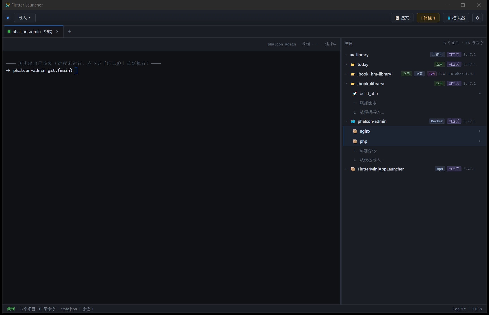
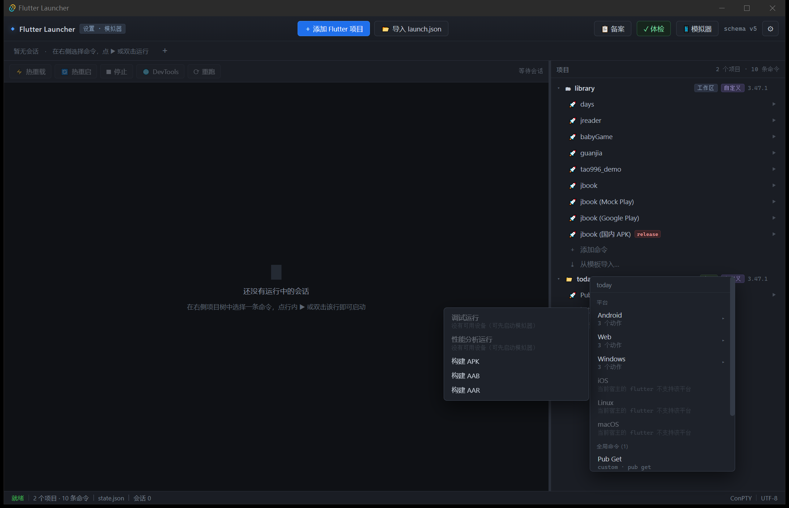
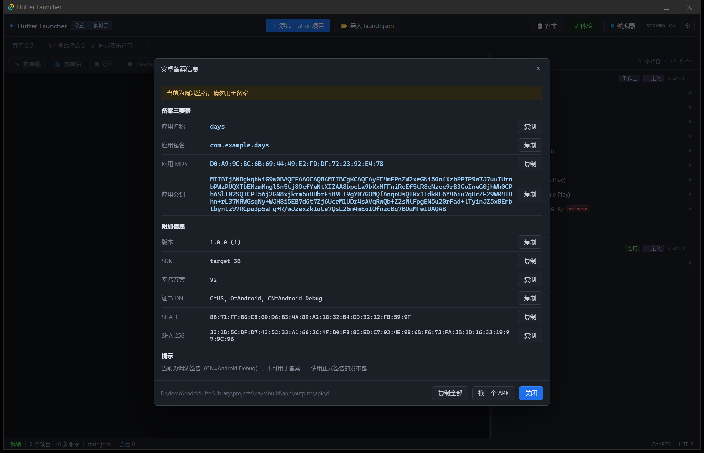

# AppDeck

> 轻量级 **多运行时应用启动器与发布管理器**：Flutter / npm / Docker Compose / 鸿蒙工程——
> 不用打开 Android Studio / VS Code，也能跑起来、热重载、打渠道包。
> 界面参考 WindTerm：高信息密度、多标签终端、层级树导航。



原名 **Flutter Launcher**（0.1.0 起更名）；`identifier` 未变，已有项目与设置不受影响。

## 功能特性

| 能力 | 说明 |
|---|---|
| 多生态项目 | Flutter / npm `package.json` / Docker Compose / 鸿蒙工程，统一项目树与命令 |
| 平台菜单 | 按「项目 + 宿主 + 设备」派生调试 / 性能分析 / 发布运行与各平台构建，不硬编码 |
| 内嵌终端 | ConPTY + xterm.js；热重载 / 热重启 / 停止 / DevTools，普通命令复用项目终端 |
| 设备与模拟器 | `flutter daemon` 列出在线设备与未启动模拟器，热插拔推送，选中即跑 |
| 构建发布 | 构建目标 / flavor 动态探测，产物按钮、结束通知、退出码 |
| APK 备案 | 包名 / MD5 / 公钥一次取全（aapt2 + apksigner + 自解析签名块） |
| 终端体验 | Ctrl+单击路径跳编辑器、日志搜索与真清空、会话恢复（tab + 历史输出） |
| 稳定性 | 原子落盘、单实例、进程树 Job Object 回收、系统托盘常驻 |

## 界面

| 平台菜单 | 备案信息 |
|---|---|
|  |  |

更多截图与功能细节见 [docs/USAGE.md](docs/USAGE.md)。

## 安装与运行

### 从源码运行

```bash
npm install
npm run tauri dev
```

首次编译 Rust 约 1.5 分钟，之后前端改动由 Vite 热更新。

### 打包安装

```bash
npm run tauri build
```

产物在 `src-tauri/target/release/bundle/`：

| 产物 | 说明 |
|---|---|
| `nsis/AppDeck_0.1.0_x64-setup.exe` | 单文件安装器（推荐，按当前用户安装） |
| `msi/AppDeck_0.1.0_x64_en-US.msi` | 需要 MSI 部署时用 |

- 绿色版：直接分发 `src-tauri/target/release/app-deck.exe`
- 只依赖 **WebView2 运行时**（Win10 1803+ / Win11 已内置）
- 版本号在 `src-tauri/tauri.conf.json`；图标母版是 `src-tauri/app-icon.svg`，
  改完执行 `npx tauri icon src-tauri/app-icon.svg` 重新生成全套图标

### 环境要求

- Windows 10 1809+（**ConPTY** 依赖；本项目在 10.0.19045 上开发）
- Rust 1.85+（msvc toolchain）、Node.js 20+
- Visual Studio Build Tools（C++ 工作负载）+ Windows SDK

## 数据与配置

| 文件 | 内容 |
|---|---|
| `%APPDATA%\cn.gu19.appdev\state.json` | 项目、命令、设置；原子写入，损坏时备份为 `state.corrupt.json` 重建 |
| `%APPDATA%\cn.gu19.appdev\sessions.json` | 会话元数据与历史输出（用于恢复 tab） |
| `%APPDATA%\cn.gu19.appdev\cache.json` | 平台矩阵 / 模拟器 / 体检结果缓存 |
| `%APPDATA%\cn.gu19.appdev\shims\` | 鸿蒙工程的 `flutter.bat` 转发脚本 |

目录跟随 `identifier`（`cn.gu19.appdev`）：改 identifier 会换目录，等于清空已有项目配置。

## 技术栈

| 层 | 选型 |
|---|---|
| 桌面外壳 | Tauri v2 |
| 前端 | Vite + TypeScript（无框架） |
| 终端 | xterm.js 6（fit / webgl / unicode11） |
| 后端 | Rust |

## 项目结构

```
src/                        前端（main.ts / styles.css）
src-tauri/src/              Rust 后端（项目 / 导入 / 终端 / 设备 / 构建 / 备案）
src-tauri/app-icon.svg      图标母版
docs/                       截图与详细文档
```

## 文档

| 文档 | 内容 |
|---|---|
| [docs/USAGE.md](docs/USAGE.md) | 功能细节与设计取舍：平台菜单、备案、多生态、终端、设置、会话恢复… |
| [docs/DEVELOPMENT.md](docs/DEVELOPMENT.md) | 里程碑、实现约束、测试、回归验证、目录结构 |
| [ARCHITECTURE_V2.md](ARCHITECTURE_V2.md) | 架构决策与源码级证据 |
| [readme_md_for_ai_agents.md](readme_md_for_ai_agents.md) | 权威规格（AI 助手必读） |
| [PROJECT_ANALYSIS.md](PROJECT_ANALYSIS.md) | v1 需求评估（历史文档） |

## 开发

```bash
npm run typecheck    # tsc --noEmit
npm run test         # cargo test（102 个测试）
npm run build        # 前端构建
```

提交前 husky 会自动跑 typecheck + test；实现约束与回归检查见
[docs/DEVELOPMENT.md](docs/DEVELOPMENT.md)。

---

仓库：<https://github.com/tao996/AppDeck>