# AppDeck 功能说明

> 本文是 [README](../README.md) 的功能细节版：每项能力怎么用、行为边界、以及踩过的坑。
> 安装、构建与目录结构见 README；里程碑与实现约束见 [DEVELOPMENT.md](DEVELOPMENT.md)。

---

## 项目管理

- **添加与识别**：目录选择器添加；自动区分「单应用」（含 `pubspec.yaml`）与「工作区」（monorepo，靠 `.vscode/launch.json` + `cwd` 定位子应用）；支持移除与重复校验
- **`launch.json` 导入**：手写 JSONC 状态机（行注释 / 块注释 / 尾逗号）；按 `type == "dart" && request == "launch"` 过滤；`cwd` 相对**工作区根**解析（VS Code 的真实语义，不是相对 `.vscode`）
- **项目树**：真实数据渲染，展示 Flutter 来源（`FVM` / `自定义` / `PATH`）、版本号、`release` 模式标记
- **折叠状态会记住**：哪些项目是折叠的写进 `state.json` 的 `ui.collapsedProjects`，
  重启后保持原样（没记录的 = 展开）。连点几下只写一次盘（300ms 防抖），
  且只保留仍存在的项目 id——删掉的项目不会在配置里留死 id
- **持久化**：`%APPDATA%\cn.gu19.appdev\state.json`，`schemaVersion: 6`，原子写入；损坏时备份为 `state.corrupt.json` 后重建
- **Flutter 探测**：解析可执行文件并执行 `--version`

## 命令模板库

- **全局模板**：设置 → 命令模板，可新建 / 编辑 / 删除 / 恢复默认（内置模板只剩 Pub Get；调试 / 构建动作由项目右键的平台菜单派生）
- **类型**：
  - `run` — `flutter run`（可指定 `-t` 入口与 debug/profile/release）
  - `build` — `flutter build <目标> --release`（目标动态探测）
  - `custom` — 任意程序 + 参数；`%FLUTTER%` 会替换成该项目的 flutter 可执行文件
  - `powershell` / `cmd` / `bash` — 直接写一条命令，分别用
    `powershell.exe -NoProfile -ExecutionPolicy Bypass -Command` / `cmd.exe /C` / `bash.exe -lc` 执行；
    落盘仍是 `custom`（program + args），`%PROJECT%` / `%CWD%` 等占位符照常可用

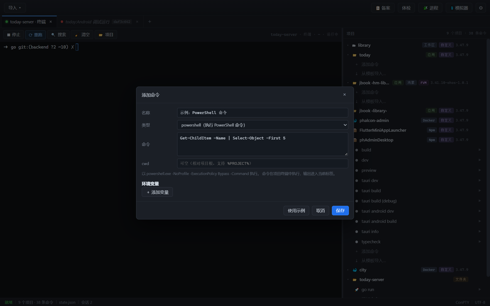
- **环境变量**：键值对随命令保存，直接注入 PTY 子进程
- **作用域**：
  - `project` — 导入到项目后才能执行
  - `global` — **项目右键即可执行，不写入项目命令列表**
- **自动套用**：新增「单应用」项目时自动把模板实例化为该项目的命令，不再是空树
- **按需导入**：项目树底部「⤓ 从模板导入…」，勾选后导入（支持全选 / 全不选，按名称+类型去重）
- **分类**：模板带 `category`（Flutter / npm / Docker / 其他），决定模板库里的分组和导入时的筛选条；
  老模板没有这个字段时按 program/args 自动推断（`%FLUTTER%`→Flutter、npm/pnpm/yarn→npm、
  docker→docker），模板库右侧的下拉可以直接改
- **工作区不自动套用**：monorepo 的命令来自 `launch.json`，避免污染

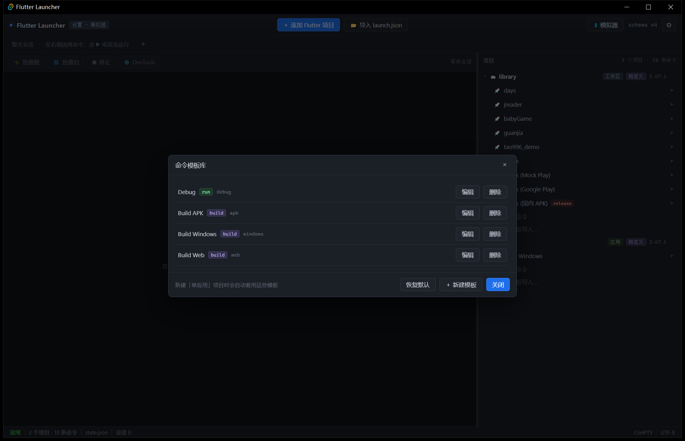

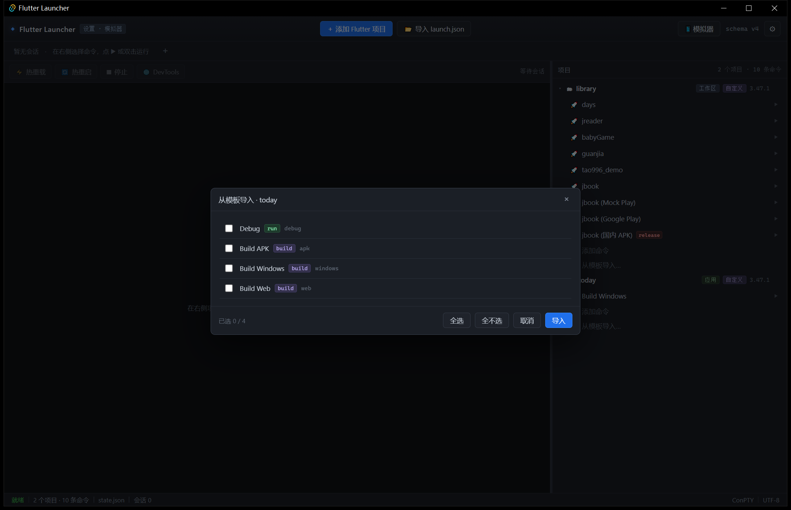

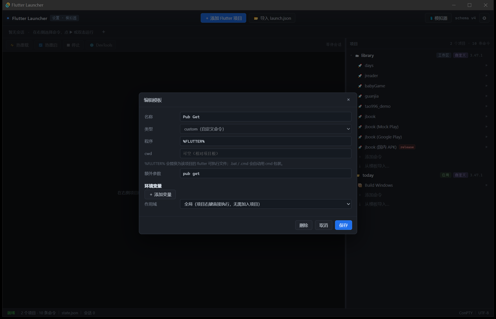

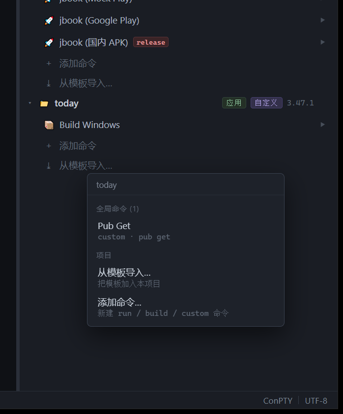

## 平台菜单、工程识别与备案

**导入了 Flutter 项目后命令为空？这是有意的。** 平台/模式组合不再存成命令，而是从
「项目 + 宿主 + 设备」动态派生：

```
右键项目
├─ 平台
│   ├─ Android ▸  调试运行 / 性能分析运行 / 构建 APK / 构建 AAB / 构建 AAR
│   ├─ Web     ▸  调试运行 / 性能分析运行 / 构建 Web
│   ├─ Windows ▸  …
│   ├─ iOS     ▸  （灰：当前宿主的 flutter 不支持该平台）
│   ├─ Linux   ▸  （灰：…）
│   └─ macOS   ▸  （灰：…）
├─ 全局命令    Pub Get
└─ 从模板导入 / 添加命令
```

- **可用性三条件**：项目有该平台目录 ∧ 宿主 `flutter build` 支持 ∧（运行类）有该平台设备
- **菜单会标出"用哪台设备"**：`Android · 6 个动作 · 23049RAD8C (daf3c642)`，
  展开后的子菜单第一行也是 `设备 · 23049RAD8C (daf3c642)`；
  没设备才写「无设备」——光看能不能跑不够，得知道跑在哪儿
- **宿主支持度**由 `flutter build --help` 的目标列表推导，**不硬编码**——
  换到 macOS 自动出现 iOS/macOS，不需要重新配
- **运行类置灰会说明原因**："没有可用设备（可先启动模拟器）"
- **工作区项目不显示平台菜单**（根目录没有平台，跑哪个子应用是歧义的）
- 派生动作**不落盘**；恢复后「⟳ 重跑」按平台重新解析设备
- **菜单直接显示真实命令**：`flutter run --debug` / `flutter run --profile` /
  `flutter run --release` / `flutter build apk --release` …，副行是中文说明
- 三种运行模式齐全：调试、性能分析、**发布模式运行（不打包）**——后者容易被漏掉，
  它是 `flutter run --release`，与 `flutter build`（只出产物、不运行）是两回事
- **缓存的只有"宿主能构建哪些目标"**（首次要跑 6 次 `flutter build <t> --help`，约十秒，
  之后跨重启有效；右键「重新分析平台信息」强制刷新）
- 点「重新分析平台信息」**菜单不会关闭**：只把「平台」那一段原地刷新，
  期间显示「平台 · 正在重新分析…」
- **设备永远现查，绝不缓存**。以前把整个平台矩阵（含"该平台有没有设备"）一起缓存，
  手机插上后菜单里永远看不到它，必须手动点「重新分析」——
  插拔是随时发生的，这类状态不能进缓存
- 模拟器列表落磁盘缓存，菜单里的 ⟳ 才重新检查
- 缓存在 `%APPDATA%\cn.gu19.appdev\cache.json`，删掉即可强制全部重算
- 分析在阻塞线程池执行，不会占住主线程卡界面

**右上角「📱 模拟器」菜单**（现在叫「设备与模拟器」）：先列**已连接设备**
（手机 / Windows / Chrome / Edge，来自 flutter daemon），再列可启动的模拟器。

- 已连接设备**每次现查**（不进缓存），点一下复制它的设备 ID
- 手机不出现时先看 `flutter devices`：能列出来但这里没有 → 点菜单右上角 ⟳ 再试


**HarmonyOS 工程**：目录里有 `ohos/` 就自动改用设置里的鸿蒙 flutter 分支
（`flutter_flutter`），平台菜单因此多出 `HarmonyOS`，构建目标是 `hap` / `app`。
标准 flutter 不认识 `ohos/`、也没有 `build hap`，所以这一步不能省。

**鸿蒙环境变量**：设置 → HarmonyOS 里有全局变量表（`DEVECO_SDK_HOME` / `FLUTTER_GIT_URL` 等），
项目右键「环境变量…」可按项目覆盖。合并顺序：

```
全局鸿蒙变量  <  .fvmrc 的 env  <  项目变量  <  命令自身 env
```

**这些变量只注入有 `ohos/` 的工程**；`.fvmrc` 的 env 属于 FVM 语义，任何工程都生效。
同一个上下文（exe + env + PATH）同时用于会话、daemon、doctor 和宿主能力探测——
不会出现"设备列表用鸿蒙分支、构建却用标准 flutter"这种分裂。

**PATH shim**：鸿蒙工程会在 `%APPDATA%\cn.gu19.appdev\shims\<项目id>\flutter.bat`
生成一个转发脚本并前置到 PATH。这样应用内手敲 `flutter`、以及构建链内部再调 `flutter`，
都会落到项目自己的分支上——**不需要改你的 `$PROFILE`**。

**FVM 工程**：项目根有 `.fvmrc` 就在名称后标 `FVM`。即使 SDK 不在
`.fvm/flutter_sdk`（走 FVM 全局缓存），也能识别出这是 FVM 工程。

**同名项目**：两个都叫 `jbook` 时，用最具区分度的祖先目录名做后缀——
`jbook ‹library›` 与 `jbook ‹hm-library›`，不会在树里混淆。

**自定义名称**：项目行悬停时右侧出现 **✎**，可以改成任意显示名。
**只改显示名，不会重命名磁盘目录**；名称会同步到新建的终端标签，
已打开的标签也会换掉前缀。重名依然可以，树里自动补 ‹父目录› 区分。

**Flutter 包名 / 应用名称**：Flutter 工程右键 →「Flutter 重命名…」，打开 rename 面板：

- 读取当前值：`rename getBundleId` / `rename getAppName`
- 平台复选框只列出项目里实际存在的目录：Android / iOS / macOS / Linux / Web / Windows
- 更新包名：`rename setBundleId --targets android,ios --value "com.example.app"`
- 更新名称：`rename setAppName --targets android,ios --value "Today"`
- 会直接改工程文件，建议先提交 Git；两个操作分别执行，未勾选的平台不动
- 设置 → Flutter 里会检查 rename 是否已通过 `flutter pub global activate rename` 安装、
  是否在 PATH 中，并提供「安装 / 更新」和 PATH 目录提示

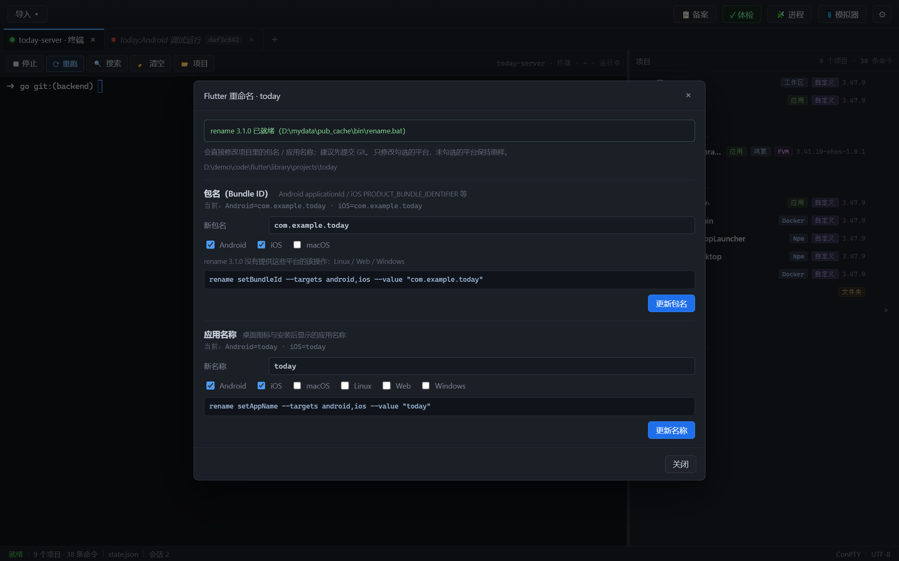

**工具栏自定义命令**：工具栏「自定义命令 ▾」→ 命令 → 运行 / 编辑 / 删除，
底部「＋ 添加命令…」。

- 适合启动任意常驻程序，例如 `npc_start.lnk`、本地服务、脚本封装的 exe
- 字段：名称、程序 / 快捷方式、参数、工作目录；选 `.lnk` 后自动解析出
  真实 exe / 参数 / 工作目录，并显示「目标：…」
- **不会经过 ShellExecute**：`.lnk` 会先解析，再把目标 exe 直接放进 AppDeck 的
  内嵌 ConPTY 终端运行。所以输出在标签页里，**不会弹出系统控制台、任务栏不会多一个窗口**
- 运行会新建「自定义 · 名称」标签；停止会结束进程但保留标签与历史，重跑会重启一条命令
- 命令保存在 `state.json` 的 `customCommands`，与项目命令 / 模板互不影响
- 暂不支持 `.bat/.cmd` 直接作为目标；需要时让快捷方式指向 exe

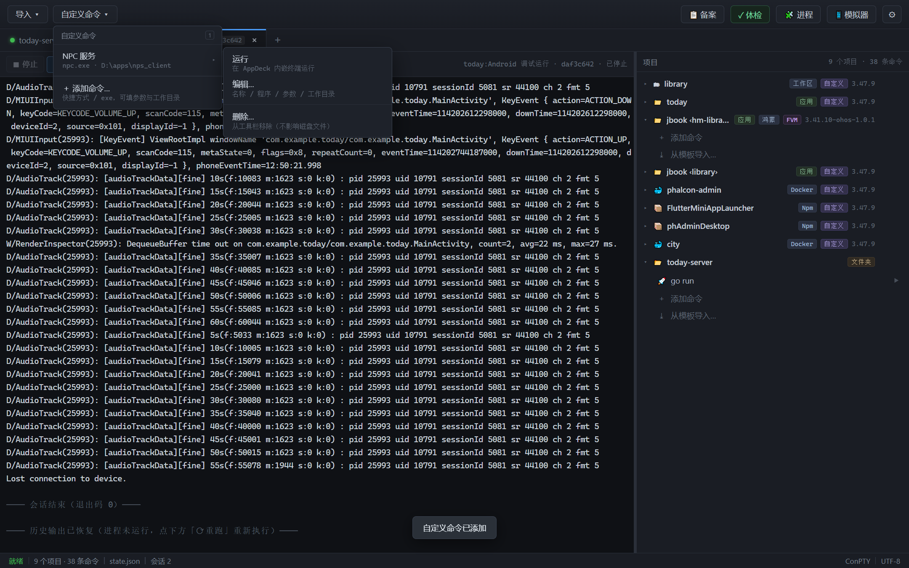

**添加文件夹 / 目录**（工具栏「导入 ▾」）：任意目录都能挂进项目树，
**不识别工程类型、也不解析任何配置文件**，所以导入后命令列表为空。
适合脚本集合、文档仓、多个工程的上级目录这类"不是 Flutter 工程、但想放几条命令"的地方；
之后用树里的「＋ 添加命令」或「⤓ 从模板导入…」补充即可。
它的右键菜单只有四项通用操作，不显示平台 / Compose / 数据库：

```
在终端中打开 / 用编辑器打开目录 / 在 Git Desktop 中打开 / 添加命令
```

> `在 Git Desktop 中打开` 需先在「设置 → Git」指定客户端；未配置时该项置灰并给出提示。

**导入 launch.json 的判定**（`import_launch_path`）：先看目录有没有 `pubspec.yaml`——
有则作为**普通 Flutter 项目**导入，launch.json 的命令成为它的自定义命令；
没有则作为**命令集**导入。命令集本身就是命令列表，右键时不显示平台也不显示全局命令。
重复导入同一目录只刷新命令，不重复添加。选目录、选 `.vscode`、直接选 `launch.json` 都可以。

**迁移（schema v4 → v5）**：`Debug` / `Build APK` / `Build Windows` / `Build Web`
四条内置模板退役，已实例化且未改名的命令一并清理；模板库只保留 `Pub Get`。
清理是**幂等**的，不依赖版本号。

**备案信息**：工具栏「📋 备案」→ 选 APK →

- 取数链路经实测选定：包名/版本用 `aapt2 dump badging`，指纹用 `apksigner verify --print-certs`
  （`keytool -printcert -jarfile` 对只有 V2 签名的 APK **直接失败**；JDK 17 的
  `keytool -list -v` **不再输出 MD5**）
- 三要素：应用名称 / 包名 / MD5，各带复制；MD5 统一成大写冒号分隔
- 附加：版本、SDK、签名方案、DN、SHA-1、SHA-256，可「复制全部」
- 调试签名会显著提示"请勿用于备案"
- **公钥**由自实现的 APK Signing Block 解析得到：定位 EOCD → Signing Block →
  V2/V3 块 → `signers → signer → signed_data → digests → certificates` → 证书 DER
  → X.509 的 SPKI → Base64
- **交叉校验**：自解析出的证书 MD5 必须等于 `apksigner` 的 MD5，不一致会在面板上告警
  （实测本机样本两者完全一致）
- 设置里可覆盖 `build-tools` 目录与 `keytool` 路径，留空自动探测

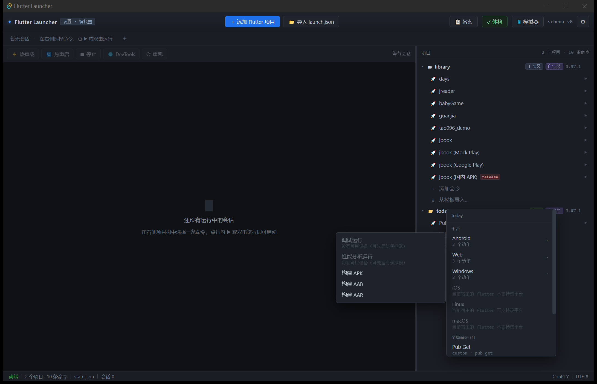

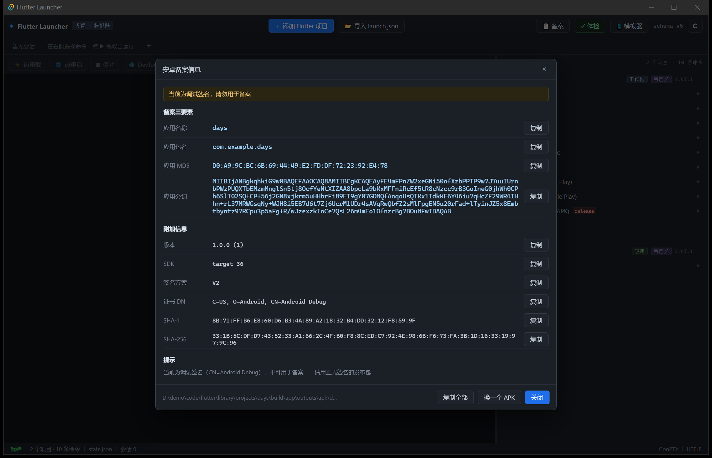

## 命令右键：按"会不会连设备"分流

**不是所有命令都该弹设备菜单。** npm 的 `build`、模板里的 `Pub Get` 跟设备毫无关系，
给它们列「自动选择 / Windows / Chrome / Pixel 5」是纯误导。

| 命令类型 | 右键菜单 |
|---|---|
| flutter run 类（`source=launch-json`，或 program 含 flutter，且 `kind=run`） | 自动选择 / 在线设备 / 可启动模拟器 / 编辑命令 |
| 其余（npm、docker、build、模板） | 运行（副标题说明落点）/ 编辑命令… / 删除命令 |

判定要照顾一个坑：`launch.json` 生成的命令 **program 是空的**（后端才拼 `flutter run`），
只看 program 会把它们误判成"不需要设备"。

## 多生态导入（npm / Docker / Qt）

**同一个目录可能既是 Flutter 工程、又是前端工程、还带 compose 文件**，
所以"生态"挂在**命令**上（`Command.source`），不挂在项目上：

| 入口（工具栏「导入 ▾」） | 生成什么 |
|---|---|
| 导入 `package.json` | 按 `scripts` 每条生成一条命令；包管理器按 lockfile 探测（pnpm > yarn > npm），设置里可强制 |
| 导入 `docker-compose.yaml` | 每个 service 生成 6 个动作 + 整份文件 3 个项目级动作 |
| 导入 Qt / CMake 工程 | 按 `CMakePresets.json` 生成配置 / 构建命令，根目录有 run 脚本时再生成「运行」 |

**转发型脚本会被展开**：`"tauri": "tauri"` 这种脚本单独一条命令毫无意义（跑起来只打印帮助），
导入时会**跑一次 `npm run tauri -- --help` 解析出子命令**，换成：

```
tauri dev              run     npm run tauri -- dev
tauri build            build   npm run tauri -- build
tauri build (debug)    build   npm run tauri -- build --debug
tauri android dev      run     npm run tauri -- android dev     ← 有 android 才出现
tauri android build    build   npm run tauri -- android build
tauri info             custom  npm run tauri -- info
```

- **子命令从 `--help` 解析，不硬编码**：tauri 升级后新增/改名照样对得上
- 只把**日常真会用的**放进去；`add` / `permission` / `completions` / `plugin` 这类
  一次性配置操作不进树（它们只是一次性的脚手架，放进去是噪音）
- `ios` 只在 CLI 真有这个子命令时才展开（Windows 上没有）
- **探测失败**（没装依赖 / CLI 不可用）就退回原来那一条裸命令，不会丢东西
- 探测约 1 秒，所以导入命令本身是 `#[tauri::command(async)]`，不占主线程
- 重复导入不会重复生成；CLI 升级后消失的子命令会被标成 `已失效`，不删


**阶段分类：`kind` 一个字段同时表示"执行方式"和"阶段"**

| kind | 含义 | 例子 |
|---|---|---|
| `run` | 长时间运行，独占终端 | `flutter run` / `npm run dev` / `docker compose logs -f` |
| `build` | 一次性产出物，结束发通知 | `flutter build apk` / `npm run build` |
| `custom` | 一次性、无产物 | `npm test` / `docker compose up -d` |

**重新导入不覆盖你的修改**：命令按确定性 id 合并，已存在的只同步执行细节
（**保留你改过的 kind 与名字**）；脚本或服务被删掉时只标「已失效」并划线，**不删数据**。

**Docker 用服务视图，不是命令列表**：

```
🐳 phalcon-admin                     Docker
   nginx        6 个操作      ▶     ← 双击 = 启动（up -d）
   php          6 个操作      ▶
   mysql        6 个操作      ▶

右键服务：启动 / 停止 / 重启 / 日志 / 进入 shell / 删除容器…（二次确认，说明"卷保留"）
右键项目：全部启动 / 全部日志 / 全部停止 / 编辑 docker-compose.yaml / 用编辑器打开目录 / 重新读取 docker-compose.yaml
```

- **用编辑器打开目录**：默认编辑器把整个项目文件夹当工作区打开（VS Code 用 `--new-window`，**开新窗口**，
  不会把当前窗口里已经打开的工程替换掉）。和终端控制条的「📂 项目」是同一套逻辑，
  区别是那个跟**当前会话的 cwd**，这个跟**项目本身**（菜单在哪个项目上点的就开哪个）
- **在 Git Desktop 中打开**：只有「设置 → Git」填了 Git 桌面客户端程序才出现。
  GitHub Desktop 自动加 `--cli-open`，其它客户端按「程序 + 目录」启动

- **编辑 xxx**：用默认编辑器打开项目的配置文件，右键点一下就跳过去
  - docker 项目 → `编辑 docker-compose.yaml`（显示**真实文件名**，可能是 `.yml` / `compose.yaml`）
  - npm 项目 → `编辑 package.json`
  - 判断依据是**文件是否真的存在**（后端 `project_files` 探测），不是项目的"生态标签"；
    所以一个目录同时有 compose 和 package.json 时两条都会出现
- 只有**这个项目真有对应文件**才显示「重新读取 xxx」（compose / package.json / launch.json 各自独立）
- 状态栏的"N 条命令"按**树里看得见的条目**计，不把折叠的服务动作算进去

## Qt / CMake 工程

工具栏「导入 ▾ → 导入 Qt / CMake 工程」选目录（也可直接选目录里的 `CMakeLists.txt` /
`CMakePresets.json`）。判定与生成：

| 目录里有 | 生成什么 |
|---|---|
| `CMakePresets.json`（含 `CMakeUserPresets.json`） | 每个 configurePreset → `配置 · <名>` = `cmake --preset <名>`；每个 buildPreset → `构建 · <名>` = `cmake --build --preset <名>` |
| 只有 `CMakeLists.txt` | 兜底 `配置 (CMake)` = `cmake -S . -B build`、`构建 (CMake)` = `cmake --build build` |
| `run.ps1` / `run.cmd` / `run.bat` | `运行` = 执行该脚本（PowerShell 脚本自动用 `-ExecutionPolicy Bypass -File`） |
| 只有 `*.pro`（qmake） | 识别为 Qt 工程，但不自动生成构建命令，提示手动补 qmake / make |

- **工具链自动定位**：Qt 工程一般没把 Qt Tools 加进 PATH（README 里都是先
  `$env:Path = "D:\apps\Qt\...\bin;...;$env:Path"`）。导入时从 preset 的
  `CMAKE_PREFIX_PATH` / `CMAKE_CXX_COMPILER` 逐级向上找 Qt 安装根，
  找到 `Tools/CMake_64/bin/cmake.exe` 就用**绝对路径**；
  Ninja 不在 PATH 时配置命令自动补 `-DCMAKE_MAKE_PROGRAM=<ninja>`，
  所以双击「配置 / 构建」就能跑，不用先开终端配 PATH
- **合并规则和 npm / compose 一样**：重复导入按确定性 id 合并，不重复添加；
  preset 被删掉时命令标「已失效」并划线，不删数据
- 项目徽章显示 `Qt`（🔧），命令行图标也是 🔧；右键有「编辑 CMakePresets.json」
  「重新读取 Qt / CMake」（文件存在时才出现）
- **配置 / 构建**是 `custom`：在**项目常驻终端**里执行，跑完 shell 还在
- **运行**是独立的 `run` 会话：`run.ps1` 拉起的 GUI 程序跑多久，标签就绿多久
  （后端等整棵进程树结束才算退出）；「停止」结束进程树，标签变红、历史保留

以 `D:\demo\code\qtProjects\mediaCutQt` 为例，导入后命令是：

```
配置 · mingw   D:\apps\Qt\Tools\CMake_64\bin\cmake.exe --preset mingw
               -DCMAKE_MAKE_PROGRAM=D:/apps/Qt/Tools/Ninja/ninja.exe
构建 · mingw   同上 cmake --build --preset mingw
运行           D:\demo\code\qtProjects\mediaCutQt\run.ps1
```

## 普通命令共用项目终端

`docker compose up -d` 跑完就退出。如果每条命令占一个标签，标签立刻变死、越堆越多，
想接着敲 `docker ps` 只能再开一个。

按执行方式分流：

| 命令类型 | 落在哪 |
|---|---|
| `custom` | **项目常驻终端**：命令被"敲"进去，跑完 shell 还在，可以接着敲下一条 |
| `run` | 独立标签，占住终端直到进程结束 |
| `build` | 独立标签 + 结束通知 + 产物按钮 |

- 同一项目的普通命令**复用同一个终端**，不会每次开新标签
- 终端标签**恢复后直接可以输入**：旧历史留在上方回滚区，新 shell 在干净的一屏里启动，
  避免 ConPTY 的绝对光标把提示符覆盖进旧日志
- 普通终端也默认显示「停止 / 重跑 / 搜索 / 清空」：
  - **停止** = 给当前命令发 `Ctrl+C`，**不会关闭 shell**；标签状态跟着命令走，
    停止后变🔴「已停止」，下次投递命令再变回🟢
  - **重跑** = 直接向当前终端重发原命令（已经停止就跳过 `Ctrl+C`），
    **在同一个 shell、同一个标签位置**执行，不会关掉终端再在末尾新开一个
- `run` 里要分两类：**flutter run** 和 **npm / docker / Qt 这类外部程序**（`npm run dev`、
  `docker compose logs -f`、`run.ps1`）：
  - 外部程序启动即算「运行中」（不再等 `Flutter run key commands.` 那行）；
  - **停止**直接结束进程树，标签与历史保留（它们没有 flutter 的 `q` 退出键）；
  - **重跑**立刻重新执行；新会话**原位替换**旧标签（不会跑到标签栏最后），
    同一条命令再次运行也不会出现两个同名标签
  - 会话是否退出按**整棵进程树**算：`run.ps1` 这类启动器自己先退出、拉起的 GUI 还在跑时，
    标签保持🟢，直到程序真正关闭（或点停止）

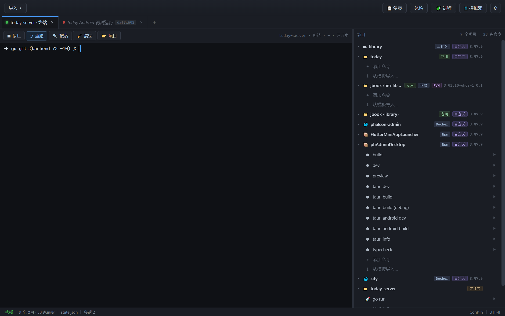

两个踩过的坑：

- **不能用 `pwsh -NoExit -Command "<cmd>"`**：实测 Flutter 退出时会把 shell 一起带走。
  必须开普通交互 shell，再把命令文本打进去（延迟 220ms，避免输入被 shell 初始化吃掉）
- **裸程序名要解析成真实可执行文件**：Docker Desktop 的 bin 里同时躺着
  `docker`（内容是 `#!/usr/bin/env sh`）和 `docker.exe`，直接 `CreateProcessW("docker")`
  会命中脚本并报 `os error 193`；`npm` 同理（真正该跑的是 `npm.cmd`）。
  现在按 PATH 依次找 `.exe` → `.cmd` → `.bat`

## 终端会话

- **ConPTY 会话**：每条命令一个伪终端（`portable-pty`），前端 xterm.js 直接渲染 ANSI 彩色输出
- **流式 UTF-8 解码**：多字节字符被数据块切断时保留尾部，中文日志不乱码
- **DSR 握手**：ConPTY 启动即发 `ESC[6n` 查询光标位置，不应答会**永久卡住**；由后端统一应答 `ESC[1;1R` 并剔除该序列（只应答一次）
- **进程树回收**：Windows Job Object + `KILL_ON_JOB_CLOSE`，关标签/退出应用时连带杀掉 `flutter → dart → gradle`
- **会话退出按进程树算（只对 PowerShell 启动器）**：`pwsh -File run.ps1` 这类脚本拉起 GUI 后自己先退，
  要等 Job 里所有进程结束才报退出；flutter / npm 等命令按自身退出**立刻**上报，
  否则设备断连（`Lost connection to device.`）后会一直绿着
- **会话状态机**：flutter run 命中 `Flutter run key commands.` → 🟢；进程退出 → 🔴 并记录退出码
- **批处理提示自动应答**：`cmd /d /c` 跑 `.cmd`（npm / pnpm / yarn）时，`Ctrl+C` 会问
  「终止批处理操作吗(Y/N)?」。没人回答，包装进程就永远不退、状态卡在运行中，
  所以 AppDeck 检测到该提示会替用户回 `Y`（一次提示只答一次）
- **控制按钮**：热重载 `r`、热重启 `R`、停止（flutter run 发 `q`；项目终端发 `Ctrl+C`；
  外部程序 / 构建直接结束进程）、重跑（项目终端在同一个 shell 里重发；run 会话新开一个后**原位替换**旧标签）、
  DevTools（从输出解析 URL 打开）
- **命令拼装**：`.bat` 经 `cmd.exe /d /c`（**不加 `/s`**），路径与参数逐项传参，避免引号被二次转义

## 终端里的路径与网址可点（Ctrl+单击）

`flutter run` 的报错栈、构建错误、`doctor`、docker 日志里都会出现位置文本，
现在可以直接点开：

| 形态 | 例子 | 打开方式 |
|---|---|---|
| 网址 | `https://demo.gu19.cn`、`http://localhost:5173/` | 系统浏览器 |
| `package:` URI | `package:tao996/src/translation/translation.dart:119:7` | 编辑器跳到 119 行第 7 列 |
| 绝对路径 | `C:/Users/mb/jbook\screenshots\a.png`（斜杠混用是真实存在的） | 系统默认程序 |
| 相对路径 | `lib/main.dart:12:5`（相对会话 cwd） | 编辑器跳到行列 |

- **Ctrl+单击**才打开（跟随 VS Code / Android Studio 终端），避免选文字时误触
- **右键**在链接上：网址给「使用浏览器打开 / 复制链接」，文件给「用编辑器打开 / 在资源管理器中定位 / 复制路径」
- 文件不存在时提示「文件不存在：<路径>」，不做静默失败
- 网址优先于“盘符路径”识别：`https://demo.gu19.cn` 不会再被拆成 `s://demo.gu19.cn`
  而提示 `s:\demo.gu19.cn` 不存在

**`package:` 怎么解析**：从会话 cwd 逐级向上找 `.dart_tool/package_config.json`，
取 `rootUri`（可能是 `file:///…` 绝对 URI，也可能是 `../../packages/foo` 相对路径），
再拼 `lib/<剩余路径>`。所以**没跑过 `flutter pub get` 的工程点不动**。

**编辑器可换**：设置 → 编辑器里指定任意 GUI 程序的 exe（VS Code / Zed / Sublime Text /
Cursor / Notepad++…），留空则自动探测（VS Code → Zed → Sublime Text → Cursor → Notepad++）。
打开方式按 exe 名分派，不会给 Zed 硬塞 `--goto`：

| 编辑器 | 打开文件（带行列） | 打开目录 |
|---|---|---|
| VS Code 及分支（Code / Cursor / VSCodium…） | `--goto 文件:行:列` | `--new-window 目录` |
| Zed / Sublime Text | `文件:行:列` | `目录` |
| Notepad++ | `-n行 文件` | `目录` |
| 其它程序 | `文件`（不拼行号，避免打开不存在的文件名） | `目录` |

**VS Code 必须选 `Code.exe`**：PATH 里的 `code` 是 `code.cmd`/无扩展名脚本，和 `npm`/`docker`
同一个坑。`Code.exe --goto "文件:行:列"` 走 argv，没有 `cmd.exe` 的引号问题，也没有注入风险。

**新版 VS Code 是「Electron 二进制 + 版本子目录」布局**：

```
Microsoft VS Code\
  Code.exe                       ← 光杆跑 --goto 会 exit 9
  e646868227\resources\app\out\cli.js   ← 真正的 app payload（目录名是版本哈希）
  bin\code.cmd                   ← 它做的就是 ELECTRON_RUN_AS_NODE=1 Code.exe <cli.js> …
```

所以要按 `code.cmd` 的方式调用：**设 `ELECTRON_RUN_AS_NODE=1`，把 cli.js 当第一个参数**。
**cli.js 靠扫描 `*\resources\app\out\cli.js` 找，不能硬编码目录名**——
VS Code 自动升级会换哈希目录（实测从 `6d62b1d5da` 变成 `e646868227`，`code.cmd` 同步改，
写死的话升级后所有"打开文件"功能立刻失效）。

> 限制：路径被终端宽度折成两行时不可点（单行内匹配）。

## 日志搜索与清空

终端控制条上多了两个按钮，**所有会话都能用**（flutter run / 构建输出 / docker 日志 / 终端）：

**🔍 搜索（Ctrl+F）** —— 浮在终端右上角，不占布局

```
┌ 日志…                        ⌃ ⌄   2/17   × ┐
```

- 计数直接显示 `当前/总数`；没有命中显示 **`0 个`**（红色）
- `Enter` 下一个 / `Shift+Enter` 上一个 / `Esc` 关闭
- **不区分大小写**（日志搜索的常见需求）
- 搜的是整个缓冲区，**包括恢复的历史输出**
- 切 tab 会自动收起（搜索是针对单个会话的）

**🧹 清空** —— 真清空，不是 Flutter 里按 `c` 那种"只清屏幕"

| 位置 | 处理 |
|---|---|
| xterm 回滚区 | `term.clear()` 清整个 buffer（**实测 673 行 → 36 行**，回滚区全没了）|
| 内存快照 | 立即 `persistSessions()` |
| `sessions.json` | 一起被覆盖成空，**重启不会又冒出来** |

- **只清显示**：不停进程、不向 PTY 发任何按键
- 不弹确认框（进程不受影响，误点代价只是丢日志）

**📂 项目** —— 用编辑器打开**当前会话的项目目录**（整个目录当工作区）

- 取的是会话的 `cwd`，所以单应用项目打开应用目录，命令带自定义 `cwd` 时打开那个子目录
- 走的是 `--new-window <目录>`，**不会替换掉当前已经打开的工程**（以前是 `--reuse-window`，一点就把原窗口的工程换掉了）
- 终端里 Ctrl+单击报错路径仍是 `--goto`（就地定位，不会每点一次多一个窗口）
- 和「编辑 xxx」是同一套编辑器设置（设置 → 编辑器）

## 进程与端口（开发排障）

工具栏 **「🧩 进程」**：默认隐藏 **Windows 核心进程**和其他会话里的服务进程；
端口页则**始终显示端口所有者**（包括系统进程），避免“8080 被占，但列表里找不到人”。

- **搜索**：名称 / PID / 端口 / 路径 / 用户，一个框全匹配；输入 `8080` 直接定位占用者
- **筛选**：`只看有端口`、`开发进程`（flutter / dart / java / node / docker…）、`显示系统/服务`
- **端口页**：TCP/UDP、本地 / 远端地址、状态、PID；默认只看 `LISTEN` / UDP 绑定，
  取消「只看监听 / 绑定」才显示已建立连接
- **结束进程**：选中后「结束进程」，或勾选「同时结束子进程」；Windows 关键进程、AppDeck 自身
  会被前后端双重拒绝
- **PID 复用防护**：结束前用快照里的启动时间再校验一次，进程已退出 / PID 被复用就跳过，
  不会误杀刚复用了同一 PID 的其他程序
- **权限**：普通权限结束管理员进程会失败并给出提示；面板右上角显示「管理员」或「普通权限」
- **服务**：Clash / MySQL 这类第三方服务默认折叠，勾「显示系统/服务」后带「服务」徽章显示，
  可以尝试结束（非管理员会得到权限不足提示）；`System32` 下的操作系统服务始终禁止
- **开发场景**：`flutter run` / `dart` / `java` 残留导致文件被锁、端口占用时，
  搜端口或勾「开发进程 + 只看有端口」，结束对应进程后重跑即可
- **端口归属注意**：`PID 4`（HTTP.sys）、WSL 的 `wslrelay`、Docker 的 `com.docker.backend`
  只是代理，杀进程 ≠ 停服务；这类进程会标「系统」
- **自动刷新**：工具栏的复选框控制是否每 2 秒刷新（默认开，窗口不可见时也会暂停）；
  关掉后仍可点「刷新」手动更新
- **隐藏规则**：点「隐藏规则」展开 textarea，**一行一个**，按程序名**包含**匹配、大小写不敏感；
  命中后进程和它的端口都不显示（例如 `svchost` / `SearchHost` / `msedgewebview2`）。
  规则与开关保存在 `state.json` 的 `ui` 段，重启后仍然生效
- **启用隐藏规则**：工具栏复选框控制规则是否生效；取消勾选后规则**保留但不过滤**，
  状态栏显示「隐藏规则已停用」。右键「隐藏此进程」在停用状态下会先自动启用规则再隐藏
- **右键隐藏**：在进程 / 端口行上右键 →「隐藏此进程」，会把这个程序名**追加**到隐藏规则并立即生效；
  想恢复时在「隐藏规则」textarea 里删掉对应行即可。右键菜单还提供结束进程 / 结束进程树 /
  显示位置 / 复制路径 / 复制 PID
- 刷新会保留搜索、筛选和选中行；选中进程被搜索/规则过滤掉时会自动取消选择

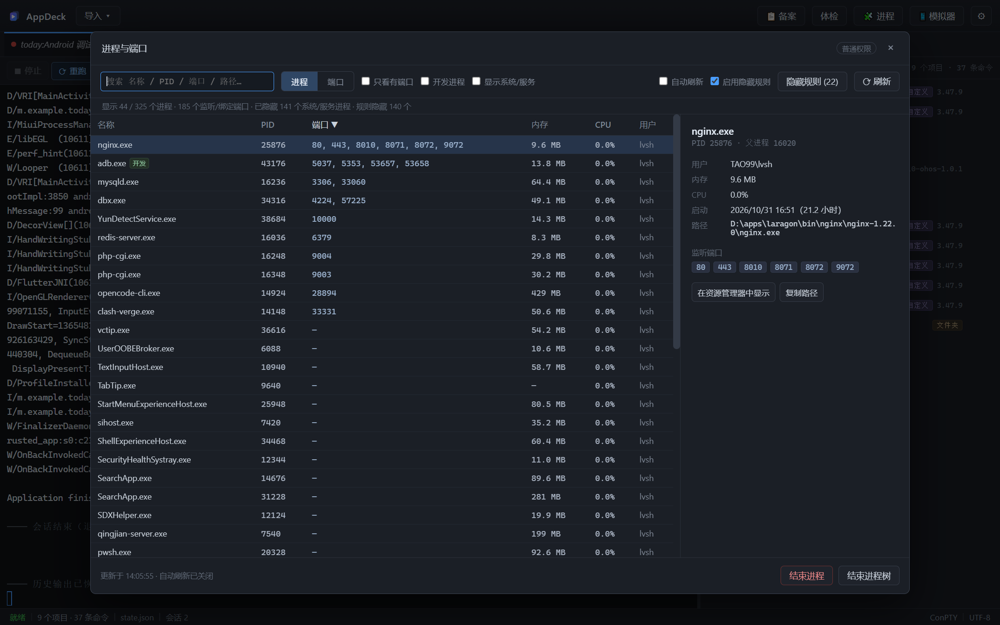

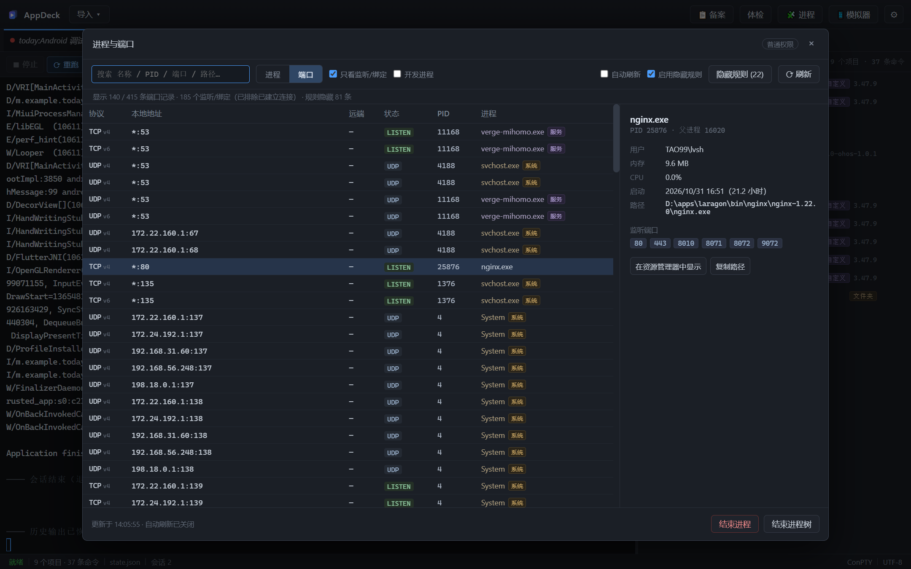

## 设备与模拟器

- **常驻 `flutter daemon`**：按 Flutter 可执行文件复用，`emulator.getEmulators` 列模拟器，
  `device.discoverDevices` 查在线设备
- **能看到未启动的模拟器**：`flutter devices` 只列在线设备，`flutter emulators --machine` 根本不存在；daemon 协议才拿得到 `Pixel_5` 这类待启动项
- **设备菜单**：右键命令弹出，分「自动选择 / 在线设备 / 可启动模拟器」；选中设备即带 `-d` 启动，选模拟器则先 `emulator.launch`
- **设备列表只查一次**：首次打开菜单才去问 `flutter daemon`（要拉起进程，好几秒），
  之后一直复用；要最新列表点菜单里的「⟳ 刷新设备列表」。
- **刷新必须走 `device.discoverDevices`**：`device.getDevices` 返回的是 daemon
  内部 `PollingDeviceDiscovery` 的**轮询缓存**，daemon 常驻时看不到后来插上的手机
  （症状：`flutter devices` 有手机，菜单里却没有）。`discoverDevices` 会丢缓存重扫 adb。
- **热插拔**：监听 `device.added` / `device.removed` 事件推送，无需轮询
- **健壮性**：daemon 超时自动杀掉重建；stderr 独立消费避免管道写满阻塞

## 应用数据库（Android 只读快照）

**不打开 Android Studio，也能看设备上 app 的 SQLite**：项目右键 →「数据库…」。

- 自动定位 adb（设置 → Android 的 SDK 目录 / `ANDROID_SDK_ROOT` / PATH）与在线设备
- 从 `android/app/build.gradle(.kts)` 读 `applicationId` 猜包名；猜不到时用当前前台应用，也可以手填
- 用 `adb run-as <包名>` 列出 `databases/` / `files/` 下的 `.db` / `.sqlite` / `.sqlite3`，点哪个拉哪个
- 拉取时连同 `-wal` 一起带走——**未 checkpoint 的最新数据也能看到**
- 内置查看器：表列表 / 字段 / 分页数据 / SQL 查询 / 导出干净的单个 `.db`
- **SharedPreferences 页签**：顶部「数据库 | SharedPreferences」切换；列出 `shared_prefs/*.xml`，
  解析成「键 / 类型 / 值」表格；支持搜索、只看 `flutter.` 键、刷新；
  string / int / long / float / boolean / set 都会展开
- **复制数据**：单元格可拖选复制，也可右键「复制单元格 / 复制整行」；
  整行用 Tab 分隔，可直接粘到 Excel
- 本机副本落在临时目录，关闭弹窗或退出应用即删除

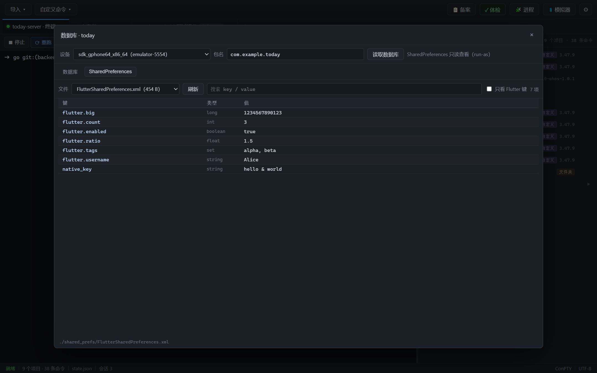

**只读是硬限制**：SQL 面板只允许 `SELECT` / `PRAGMA` / `WITH` / `EXPLAIN`；
后端用 `Statement::readonly()` 加 `PRAGMA query_only` 双重拦截，写语句直接报错。
要改数据请导出副本后用 DB Browser / DataGrip 改（不会同步回设备）。

**和 Studio 的 Database Inspector 的区别**：

| | AppDeck 数据库 | Studio Database Inspector |
|---|---|---|
| 依赖 | 只要 adb | 需要 IDE + JDWP 调试通道 |
| 实时性 | 拉取那一刻的快照，点「读取数据库」重拉 | 实时 |
| 写操作 | 只读 | 可改（写回设备） |
| 前置条件 | debug 包（`run-as`） | debuggable 包 |


## 设置页与模拟器菜单

- **工具栏「📱 模拟器」**：聚合两个来源，点条目即启动
  - Android AVD ← 直接驱动 `emulator.exe -list-avds`，并把设置里的
    SDK / AVD 目录通过 `ANDROID_AVD_HOME` 等注入子进程（自定义 AVD 目录才真正生效）；
    未配置时回退 `flutter daemon`
  - HarmonyOS 实例 ← DevEco `Emulator.exe -list`
- **列表缓存**：模拟器列表首次打开查询并缓存，之后直接渲染；点标题栏右侧 **⟳** 才重新检查。
  已连接设备**每次打开都现查**（手机随时插拔），标题栏会显示「设备更新于 HH:mm:ss」
- **设置页**（⚙）**单页垂直滚动**（不分页签；弹窗固定尺寸，内容内部滚动），分区顺序：
  窗口与托盘 → 命令模板 → 会话恢复 → 终端 → 编辑器 → Git → Flutter → Android → 鸿蒙 → Npm → Docker
  - 左下角显示**最后一次编译（打包）的时间**（`AppDeck · 最后编译 2026/10/29 00:16:12`），
    取 exe 修改时间与前端打包时间的较大者
  - 窗口与托盘：关闭按钮行为（**退出程序** / **最小化到托盘**）。托盘图标常驻：
    左键或双击恢复窗口，右键菜单有「显示主窗口 / 退出」；选「最小化到托盘」时关窗不会中断正在跑的构建
  - 命令模板库入口 / 会话恢复 / 终端程序 / 默认编辑器（可换 VS Code / Zed / Sublime Text…）
  - Git：Git 桌面客户端程序（GitHub Desktop / SourceTree…）。**填了才在项目右键出现
    「在 Git Desktop 中打开」**；GitHub Desktop 自动走 `--cli-open`，其它客户端按
    「程序 + 目录」启动
  - Flutter：`auto` / `custom` / `fvm` + 自定义路径；rename CLI 状态（版本 / 是否在 PATH），
    可「安装 / 更新」执行 `flutter pub global activate rename`，未进 PATH 时给出 pub bin 目录。
    检查结果会缓存：首次打开检查一次，之后打开项目/设置不再重复跑
    `flutter pub global list`；点「重新检查」或安装/更新后才刷新

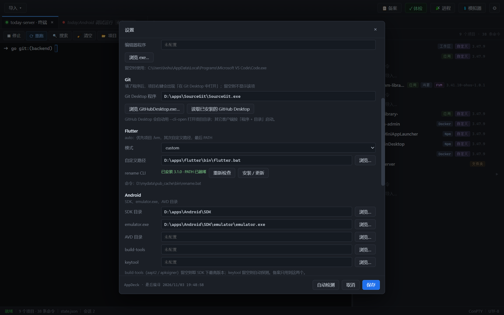
  - Android：SDK 目录 / `emulator.exe` / AVD 目录 / build-tools / keytool
  - 鸿蒙：`Emulator.exe` 目录 / 实例目录 / 镜像目录 / 鸿蒙 Flutter 分支 / SDK / 全局环境变量
  - Npm：包管理器（auto/npm/pnpm/yarn）/ node 目录
  - Docker：docker 路径 / compose 风格（v2 / v1 / auto）
- **一键自动检测**：不扫全盘，只用环境变量 + `hdc.exe` 反推 + 常见安装位置。
  **只探测、不写入**——检测结果与输入框里的值不一致时（多半是用户手填过），
  在输入框下方显示 `检测到：<值>` + 「填写」按钮，点它才覆盖。
  填一次、存一次盘，不想用就无视它。
- **开箱即用**：HarmonyOS 路径未配置时自动回退到探测结果


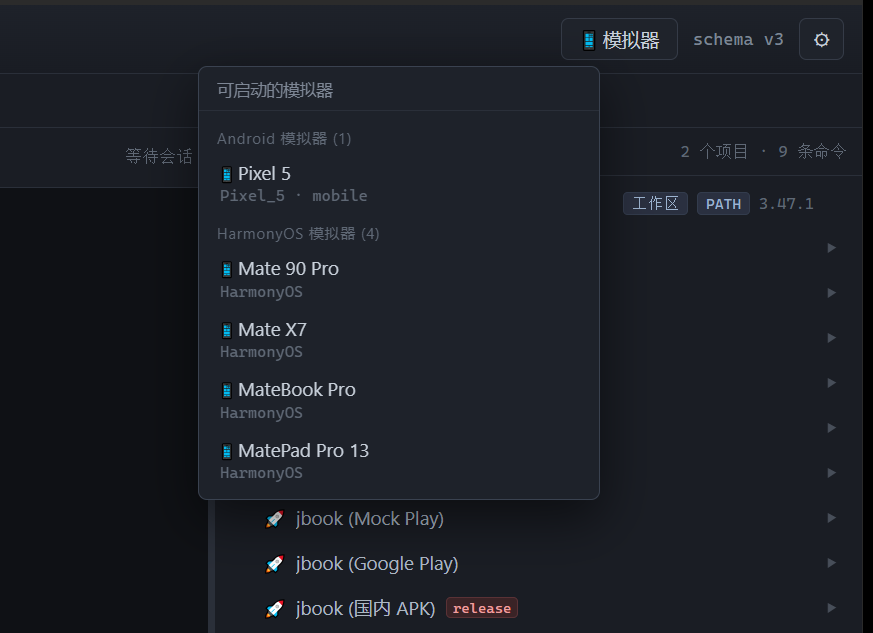

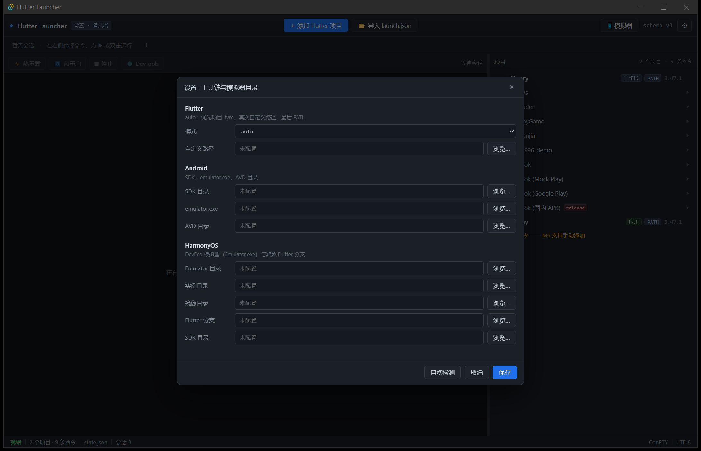

## 构建与产物

- **构建目标动态探测**：解析 `flutter build --help` 的子命令列表，**不硬编码**。
  Windows 宿主没有 `ipa` / `macos`
- **flavor 支持度探测**：逐个执行 `flutter build <target> --help` 检查是否含 `--flavor`
  （实测 `apk`/`windows` 支持，`web` 不支持），不支持时输入框置灰
- **命令编辑对话框**：树里「＋ 添加命令」可建 run / build / custom / powershell / cmd / bash 命令；
  右键命令可编辑或删除
- **产物解析**：从终端流里匹配 `✓ Built <path>`，在控制条生成 `📦 产物名` 按钮，点击在资源管理器定位
- **构建通知**：结束（成功或失败）发系统通知，含项目与产物/退出码
- **退出码可见**：终端末尾打印 `──── 会话结束（退出码 N）────`，标签转 🔴

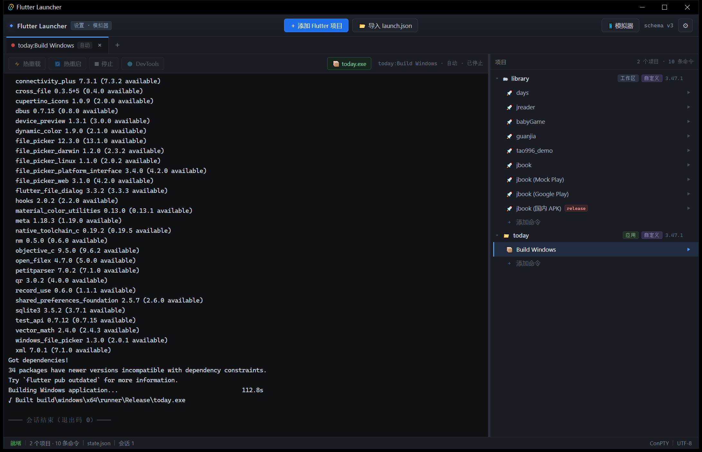

## 体检

启动后后台跑一次 `flutter doctor`，状态直接显示在工具栏按钮上，点开是完整报告：

| 状态 | 按钮 |
|---|---|
| 进行中 | `⏳ 体检` |
| 全部正常 | `✓ 体检`（绿） |
| 有问题 | `! 体检 N`（黄，N = 问题项数） |
| 执行失败 | `✗ 体检`（红，悬停看原始报错） |

- **符号陷阱**：`flutter_tools/lib/src/base/logger.dart:738` 在 `supportsEmoji == false` 时
  把 `✓` 换成 `√`、`✗` 换成 `X`、`⚠️` 换成 `!`。解析器**两套符号都接受**，
  否则在中文终端上永远匹配不到状态行
- **修复指引**：从 `To resolve this, run:` 与已知问题表里提取命令，可复制
- **在终端执行**：白名单内的修复动作（如 `flutter doctor --android-licenses`）
  可直接起一个 PTY 会话跑，许可证确认可交互输入 `y`
- 失败时原样呈现 Flutter 自己的报错，而不是"未知错误"
- **不主动跑，只读缓存**。`flutter doctor` 实测 **23 秒**，属于"一次就好"的操作：
  - 启动时只用磁盘缓存（`cache.json` 的 `doctor` 段），**不会**触发探测
  - 没有缓存时按钮显示中性的 `体检`，点一下才真正运行
  - 结果不设过期：除非用户点「重新检查」，否则一直用缓存
  - 代价是可能看到旧结果——报告里带检查时间，介意就点一次刷新
- **必须跑在线程池上**（`#[tauri::command(async)]`）：早期它是同步命令，
  在 Tauri v2 里同步命令跑在**主线程**——启动时界面会整整冻结 23 秒
  （Windows 直接标记"无响应"），连关闭窗口也要等它跑完（实测退出要 8-11 秒）。
  改成异步后：启动 1 秒内可交互、退出 0.2 秒


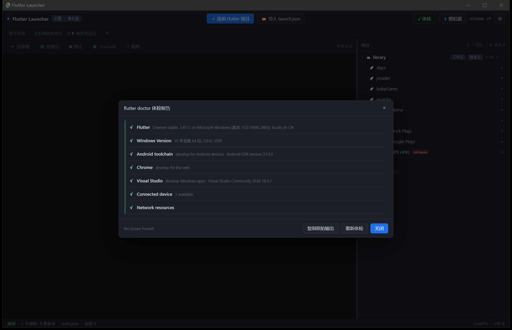

## 会话恢复

重启应用后，**tab 壳与历史输出都在，但进程不自动拉起**：

- 元数据（标题、设备、模式、所属项目/命令/模板、退出码、产物）随会话落盘
- 终端缓冲用 `@xterm/addon-serialize` 序列化成 ANSI 原样保存并回放
- 恢复的 tab 带 `恢复` 角标，状态 🔴「已停止」，控制条点亮 **⟳ 重跑**
- **恢复的 tab 在被点「重跑」之前绝不写 PTY**：键盘输入只提示，不转发
- 预算：单会话 ≤ 2 MB、全局 ≤ 20 MB、最多 20 个；超出时从最旧内容截断
- `sessions.json` 损坏时备份为 `sessions.corrupt.json` 后重建

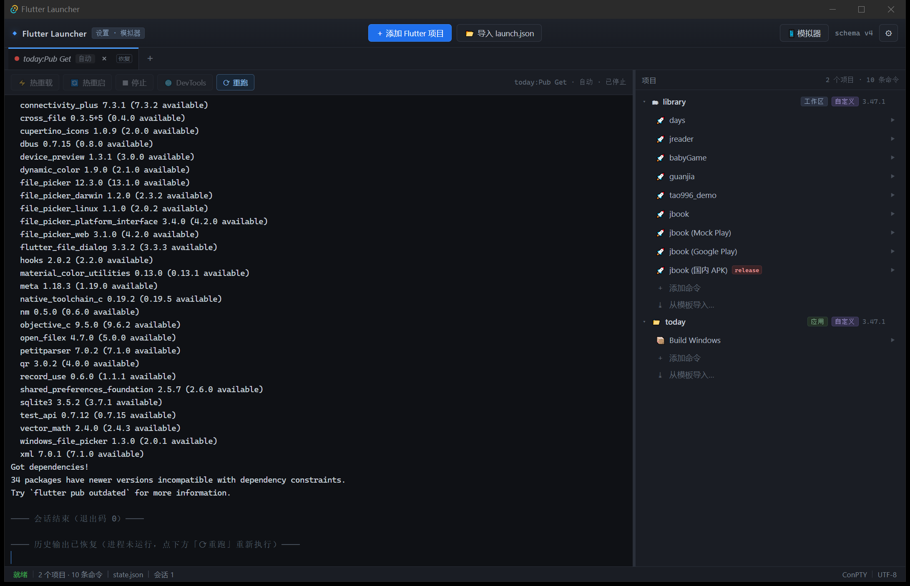

